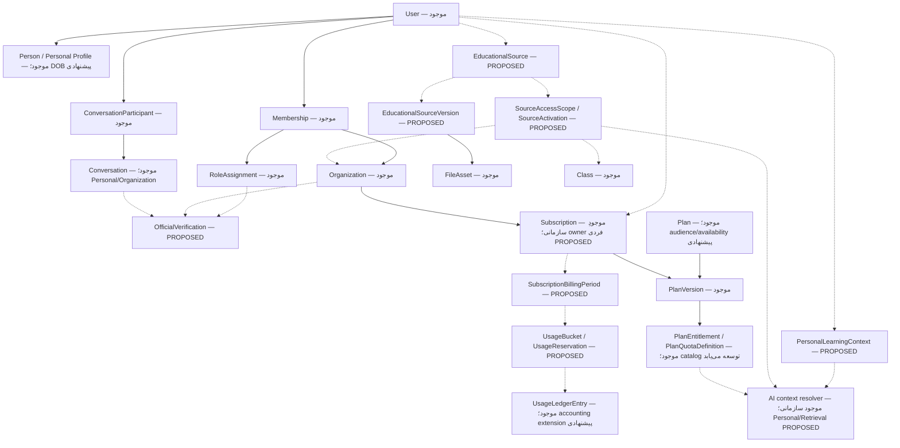

# MakanApp — مدل محصول، قواعد کسب‌وکار و جهت معماری نسخهٔ ۲

بازبینی تکمیلی `2026-10-30` از `main@e11d4ec`: پروفایل، مدرسه، اشتراک Individual/Organization، دورهٔ ماهانه، reserve/settle و بنیاد PersonalClass در کد موجودند. replay حساب و پیوست آزمون هم افزوده شده‌اند. ممیزی baseline بخش۲۴ و طرح‌های۲۶..۳۳ مربوط به قبل از اجرا هستند؛ قسمت‌های تحقق‌یافتهٔ آن‌ها با قراردادهای [اشتراک](SUBSCRIPTION_ENTITLEMENT_QUOTA_IMPLEMENTATION_FA.md)، [Realtime](REALTIME_EVENT_CONTRACT_FA.md) و [پیوست](ACADEMIC_ANSWER_ATTACHMENTS_IMPLEMENTATION_FA.md) جایگزین می‌شوند. Learning Profile، Badge، Source lifecycle/RAG، AI Runtime شخصی و چرخهٔ کامل آموزشی PersonalClass همچنان خارج از قابلیت جاری‌اند؛ نام/قیمت/سقف پولی یا Refund نهایی از این سند استنتاج نشود.

تاریخ ممیزی: `2026-10-28` — مخزن: `MakanApp-Backend` — شاخه: `main` — مبنای Git: `b87fbd89cef33f26315fddd4a1e57116b44cc781`.

این سند **پیشنهاد Source of Truth برای مدل آیندهٔ محصول** است؛ ثبت آن به معنی پیاده‌سازی، تأیید همهٔ جزئیات پیشنهادی، اعمال Migration یا استقرار نیست. وضعیت جاری از فایل‌های واقعی Working Directory استخراج شده است؛ تغییرات قبلی CORS و فایل‌های ناتمام AI جزو خروجی این کار نیستند. هیچ پایگاه داده یا سروری برای این ممیزی بررسی عملیاتی نشده است.

معنای برچسب‌ها:

| برچسب | معنای دقیق |
|---|---|
| `CURRENTLY IMPLEMENTED` | در کد موجود است؛ شاهد فایل، کلاس، متد، قرارداد یا تست در همین سند معرفی شده است. اثبات اجرای موفق در سرور نیست. |
| `PROPOSED / NOT IMPLEMENTED` | هدف جدید محصول یا قابلیتی که در Backend ممیزی‌شده وجود ندارد. |
| `PROPOSED DESIGN` | راه‌حل معماری پیشنهادی برای تحقق هدف؛ هنوز تصمیم نهایی طراحی نیست. |
| `PROPOSED - OWNER APPROVAL REQUIRED` | فیلد یا جزئیات تکمیلی خارج از نیاز صریح مالک که بدون تأیید او نباید پیاده‌سازی شود. |
| `OPEN BUSINESS DECISIONS` | تصمیم تجاری یا سیاستیِ تعیین‌نشده؛ عدد، قیمت و رفتار نهایی برای آن فرض نشده است. |

## 1. Executive Summary

اصل محصول: **هویت حساب مستقل از نقش سازمانی است.** سازمان و نقش، قابلیت رسمی اضافه می‌کنند؛ پایان نقش نباید حساب و دارایی شخصی را حذف کند. کاربر مستقل باید بتواند پروفایل، پیام‌رسانی مجاز، اشتراک فردی، AI شخصی و منابع آموزشی شخصی/عمومی داشته باشد، بدون ساخت مدرسهٔ صوری.

نتیجهٔ ممیزی با اصلاح وضعیت جاری:

- `CURRENTLY IMPLEMENTED`: جدایی `User`، `Person`، `Membership` و `RoleAssignment`؛ Workspace شخصی؛ Contacts و Personal Direct؛ گروه/کانال شخصی با محدودیت‌های سن و ایمنی؛ گروه رسمی کلاس؛ Commerce فردی/سازمانی با نسخه، دوره، Quote و رزرو؛ بنیاد PersonalClass؛ AI سازمانی با Context سمت Backend و Runtime پیش‌فرض خاموش.
- `PROPOSED / NOT IMPLEMENTED`: پروفایل آموزشی شخصی، Badge رسمیت سازمانی، AI Runtime شخصی و Educational Source/RAG lifecycle. بنیاد اشتراک فردی/سازمانی، دوره، quotaهای قراردادی، رزرو و PersonalClass اکنون موجود است؛ این foundation به معنی فعال‌بودن Runtime AI یا workflow کامل محتوای کلاس مستقل نیست. DOB و ProfilePhoto نیز CURRENTLY IMPLEMENTED هستند.
- گزارش «Messaging فقط با School Role کار می‌کند» به‌صورت یک قاعدهٔ عمومی در کد تأیید نشد. تست واقعی مخزن برای دو Adult تأییدشدهٔ بدون مدرسه وجود دارد. با این حال، Workspace انتخاب‌شده، پروفایل ناقص، وضعیت سن، رابطهٔ مجاز و Privacy می‌توانند عملیات کاربر عادی را محدود کنند؛ جزئیات در بخش 24 آمده است.
- `CURRENTLY IMPLEMENTED`: Person.DateOfBirth اختیاری و خوداظهاری در self، و User.ProfilePhotoFileAssetId با FileAsset شخصی JPEG/PNG. VerifiedBirthDate شاهد مستقل سن است؛ هیچ‌یک دیگری یا مجوز ارتباط را نمی‌سازند.

مأموریت ممیزی اولیه فقط همین سند را اضافه کرده بود؛ baseline و شواهد آن تاریخچه‌اند. بازبینی جاری وضعیت DOB/Photo/School ثبت‌شده در کد را اصلاح می‌کند و اجرای migration، deployment یا پیاده‌سازی سایر پیشنهادها نیست.

## 2. Product Principles

1. حساب مستقل: `User Identity ≠ Organization Role`؛ «Ordinary User» وضعیت نداشتن نقش سازمانی است، نه Role جدید سراسری.
2. پروفایل پایه یک‌بار و زیر اختیار خود فرد تکمیل می‌شود؛ عضویت چندسازمانی، هویت تکراری نمی‌سازد.
3. Personal و Organization مرز مالکیت/مجوز هستند. تغییر Workspace در رابط نباید مالکیت Conversation یا منبع را تغییر دهد.
4. خرید اشتراک مجوز ورود به کلاس، خواندن چت یا مشاهدهٔ منبع دیگران نیست. Entitlement، Authorization و Safety باید هم‌زمان برقرار باشند.
5. نقش Teacher/Parent/Student/Manager دلیل حذف ارتباط شخصی مجاز نیست؛ سن، رابطه، Block، Privacy، نشست و محدودیت حساب همچنان اعمال می‌شوند.
6. `UnknownAge` در عملیات حساس Messenger مانند Minor محافظت می‌شود. استقلال از مدرسه، راه عبور از GAP-05 نیست.
7. Backend مرجع Context، Quota، زمان و مجوز است؛ ورودی Role/OrganizationId/SourceId یا پاسخ AI مجوز ایجاد نمی‌کند.
8. قیمت و سقف مصرف دادهٔ نسخه‌دارِ پلن‌اند. افزودن arbitrary feature توسط Owner نباید خودبه‌خود کد اجرایی یا مجوز جدید بسازد.
9. دارایی شخصی با حذف نقش پاک نمی‌شود؛ حفظ داده با مجازبودن دائمی خواندن دادهٔ رسمی یکسان نیست.
10. `.NET 9`، `EF Core 9`، SQL Server، Onion Architecture، Modular Monolith و Controller-based API ثابت می‌مانند؛ ماژول جدید فقط هنگام اجرای قابلیت واقعی ایجاد می‌شود.

مراجع: [SQL Server Override](../project-context/01_SQLSERVER_ARCHITECTURE_OVERRIDE.md)، [معماری تاریخی](../project-context/02_Makan_Architecture_v3_Original_MySQL_Reference.pdf)، [UX](../project-context/03_Makan_User_Flows_and_Screens_UX_v1.0.pdf)، [Messenger Master PRD v3.0](../messaging/MakanApp_Messenger_Master_PRD_v3.0_FA.pdf)، [تصمیم‌های Backoffice](../architecture/BACKOFFICE_PRODUCT_DECISIONS.md)، [GAP-05](../architecture/GAP_05_MESSENGER_CHILD_SAFETY.md).

PRD هدف محصول است و اثبات پیاده‌سازی نیست. مثال‌های API آن، Current API تلقی نشده‌اند. قواعد جدید مصوب ایمنی و الحاقیهٔ حذف MFA مورخ `2026-10-24` بر متن تاریخی همان حوزه مقدم‌اند؛ این سند MFA موازی یا بازگشت عامل دوم پیشنهاد نمی‌کند. تصمیم‌های دیتابیسی MySQL در PDF قدیمی منسوخ‌اند.

## 3. User vs Role Model

`CURRENTLY IMPLEMENTED` — مدل واقعی:

| مفهوم واقعی | مسئولیت و استقلال |
|---|---|
| `User` | حساب و وضعیت امنیتی؛ می‌تواند پیش از تکمیل Profile، `PersonId` نداشته باشد. |
| `Person` | اطلاعات نام فرد؛ می‌تواند برای پروندهٔ مدرسه بدون حساب نیز وجود داشته باشد. |
| `UserCredential` / `UserSession` | شناسهٔ ورود و نشست؛ نقش مدرسه داخل هویت عمومی حساب ادغام نشده است. |
| `OrganizationPerson` | پروندهٔ فرد در سازمان؛ معادل User یا Membership نیست. |
| `Membership` | اتصال حساب به سازمان، با وضعیت مستقل. |
| `RoleAssignment` | نقش Student/Teacher/Parent/Manager روی Membership؛ چند نقش و چند سازمان ممکن است. |
| `Enrollment` / `TeacherAssignment` / `GuardianRelation` | رابطهٔ آموزشی/سرپرستی؛ از عنوان نقش به‌تنهایی نتیجه نمی‌شوند. |
| `PlatformRoleAssignment` | دسترسی Backoffice؛ مستقل از نقش آموزشی. Manager مدرسه Platform Admin نیست. |

شواهد: [User](../../MakanApp.Domain/Identity/User.cs)، [Person](../../MakanApp.Domain/Identity/Person.cs)، [Membership](../../MakanApp.Domain/Organization/Membership.cs)، [RoleAssignment](../../MakanApp.Domain/Organization/RoleAssignment.cs)، [OrganizationPerson](../../MakanApp.Domain/Organization/OrganizationPerson.cs)، [AccessContext](../../MakanApp.Application/Organization/OrganizationContracts.cs).

`PROPOSED DESIGN`: همین جدایی حفظ شود. لایهٔ نمایش می‌تواند یک «Personal Profile» ترکیبی از `Person` و `User` ارائه کند؛ ایجاد جدول تکراری `UserProfile` صرفاً به دلیل نام مفهومی لازم نیست. عنوان تجاری «پلن معلم» به خریدار نقش Teacher یا Badge نمی‌دهد.

## 4. Identity Lifecycle

`CURRENTLY IMPLEMENTED`: درخواست OTP و Verify از `AuthController` به `IdentityService` می‌رود. حساب جدید می‌تواند Profile ناقص داشته باشد؛ `CompleteProfileAsync` نام‌ها را در Person و Username را در User ثبت می‌کند. `User.IsProfileComplete` بر PersonId و Username متکی است. نشست، Role و Membership چرخهٔ مستقل دارند. رفتار Real/Mock موجود در این سند بازطراحی نمی‌شود.

`PROPOSED DESIGN` — مسیر محصول، با وضعیت‌های مستقل و قابل ترکیب:

```text
حساب ثبت‌شده -> پروفایل ناقص -> پروفایل تکمیل‌شده
                                |-> امکانات شخصیِ مجاز
                                |-> اشتراک فردی اختیاری [PROPOSED]
                                |-> دعوت سازمانی اختیاری -> پذیرش -> Membership
                                                                  -> RoleAssignment
                                                                  -> روابط آموزشی جداگانه
پایان نقش/عضویت -> پایان مجوز رسمیِ وابسته -> حساب و دارایی شخصی باقی می‌مانند
تعلیق حساب/ابطال نشست -> محدودیت امنیتی مستقل، حتی اگر اشتراک پرداخت شده باشد
```

Membership نباید شرط ایجاد حساب یا خرید فردی شود. پذیرش دعوت نباید خودکار حساب دوم، Credential، شمارهٔ تأییدشده، Enrollment یا TeacherAssignment بسازد. انطباق نام/تلفن خانوادگی مجوز Merge/Link نیست؛ جریان رضایت اتصال GAP-01 باید استفاده شود.

شواهد: [AuthController](../../MakanApp.Api/Controllers/AuthController.cs)، [IdentityService](../../MakanApp.Application/Identity/IdentityService.cs)، [OrganizationService.AcceptInvitationAsync](../../MakanApp.Application/Organization/OrganizationService.cs).

## 5. Professional Profile

### 5.1 وضعیت واقعی و پاسخ روشن دربارهٔ DOB

`CURRENTLY IMPLEMENTED`: CompleteProfileCommand نام‌ها/Username و dateOfBirth nullable را می‌گیرد؛ CurrentUserResult در self/login، dateOfBirth و profilePhoto دارد. null/omission DOB قبلی را حفظ می‌کند و آینده رد می‌شود؛ DOB/ProfilePhoto prerequisite تکمیل جدید نیستند. Person.DateOfBirth به SQL date nullable نگاشت شده؛ schema عکس مرجع User با FK/unique filtered است، نه جدول پروفایل تکراری.

```text
DateOfBirth currently exists in DB? YES
DateOfBirth currently exists in Domain? YES
DateOfBirth currently exists in API Request? YES
DateOfBirth currently exists in API Response? YES
```

دامنهٔ این چهار پاسخ، **فیلد DateOfBirth پروفایل عمومی/شخصی مورد درخواست** و schema نسخه‌دار مخزن است؛ وضعیت دیتابیس زنده ممیزی نشده است. استثنای مهم: `VerifiedBirthDate` در Domain و جدول `identity.CommunicationAgeVerifications` و درخواست `VerifyCommunicationAgeCommand` موجود است، اما پاسخ آن `CommunicationAgeResult` تاریخ تولد را برنمی‌گرداند. این endpoint مخصوص تأیید سن و دارای مجوز است؛ جایگزین self-profile نیست.

شواهد کامل: [Person.cs](../../MakanApp.Domain/Identity/Person.cs)، [IdentityContracts.cs](../../MakanApp.Application/Identity/IdentityContracts.cs)، [IdentityService.CompleteProfileAsync / BuildCurrentUserAsync](../../MakanApp.Application/Identity/IdentityService.cs)، [PersonConfiguration.cs](../../MakanApp.Infrastructure/Persistence/Configurations/Identity/PersonConfiguration.cs)، [EF Snapshot](../../MakanApp.Infrastructure/Persistence/Migrations/MakanDbContextModelSnapshot.cs)، [ProfileController](../../MakanApp.Api/Controllers/ProfileController.cs)، [CommunicationAgeService](../../MakanApp.Application/Messaging/CommunicationAgeService.cs)، [AgeVerification EF](../../MakanApp.Infrastructure/Persistence/Configurations/Identity/CommunicationAgeVerificationConfiguration.cs).

### 5.2 Schema پیشنهادی و مالکیت هر فیلد

جدول زیر وضعیت و طراحی هدف را جدا می‌کند. «عمومی» به معنی در دسترس برای viewer مجاز تحت Privacy است، نه فهرست عمومی همهٔ کاربران.

| فیلد | وضعیت | Required / Optional | Editable / Immutable | مالک | Public / Private | Searchable / Non-searchable |
|---|---|---|---|---|---|---|
| `User.Id` | `CURRENTLY IMPLEMENTED` | Required پس از ثبت | Immutable | Identity | شناسهٔ فنی در پاسخ‌های مجاز؛ به‌تنهایی مجوز نیست | Non-searchable به معنی عدم فهرست‌سازی آزاد؛ lookup مجاز ممکن است |
| `Person.FirstName` | `CURRENTLY IMPLEMENTED` | Required هنگام تکمیل | Editable | User در self-profile | self؛ ممکن است در نام نمایشی fallback دیده شود | جست‌وجوی فعلی نمایش نام تابع Directory/Privacy است |
| `Person.LastName` | `CURRENTLY IMPLEMENTED` | Required هنگام تکمیل | Editable | User در self-profile | مانند FirstName | مانند FirstName |
| `Person.DisplayName` | `CURRENTLY IMPLEMENTED` | Optional | Editable | User | نام نمایشی مجاز؛ nullable | جست‌وجوی Directory با قواعد فعلی |
| `User.Username` | `CURRENTLY IMPLEMENTED` | Required برای Profile complete | Editable با uniqueness | User | در Messaging profile مجاز | Searchable با endpoint و محدودیت Discovery |
| `PhoneNumber` | `CURRENTLY IMPLEMENTED` | شناسهٔ ورود فعلی | از PATCH Profile قابل‌ویرایش نیست | Identity | self؛ نمایش/کشف برای دیگران تابع دو Privacy مستقل | فقط Resolve مجاز؛ نه فهرست تلفن‌ها |
| `Person.DateOfBirth` | `CURRENTLY IMPLEMENTED` | Optional؛ prerequisite تکمیل نیست | Editable self، null/omission حفظ مقدار؛ clear تعریف نشده | User مستقل از مدرسه | Private self؛ شاهد سن تغییر نمی‌کند | Non-searchable |
| `VerifiedBirthDate` | `CURRENTLY IMPLEMENTED` در evidence جدا | Required هنگام ثبت verification | evidence جدید از workflow مجاز؛ نه ویرایش مستقیم self | مرجع تأیید سن | Private؛ پاسخ عمومی سن دقیق ندارد | Non-searchable |
| `CommunicationAgeCategory/VerificationStatus` | `CURRENTLY IMPLEMENTED` | وضعیت امنیتی حساب | فقط workflow معتبر | سیستم/مرجع تأیید | self-status و projections مجاز | فیلتر کشف عمومیِ سن دقیق نیست |
| `User.ProfilePhotoFileAssetId` | `CURRENTLY IMPLEMENTED` | Optional | PUT انتخاب/تعویض و DELETE مرجع | User | عکس تابع نمایش هویت مجاز؛ دانلود Bearer، بدون URL عمومی | Non-searchable |
| `Bio` | `PROPOSED - OWNER APPROVAL REQUIRED` | Optional | Editable | User | audience باید تصویب شود؛ پیش‌فرض عمومی فرض نشود | Non-searchable تا تصویب |
| `PreferredLanguage` | `PROPOSED - OWNER APPROVAL REQUIRED` | Optional | Editable | User | Private | Non-searchable |

فیلدهایی مانند شماره ملی، نشانی منزل، جنسیت، مدرک هویتی و اطلاعات شغلی حساس، بدون نیاز مشخص به Profile اضافه نمی‌شوند. Grade/Level در Personal Learning Context قرار می‌گیرد و نقش سازمانی از Profile قابل self-claim نیست.

### 5.3 نوع، اعتبارسنجی و سازگاری DOB

`PROPOSED DESIGN`: `DateOnly?` در .NET و `date NULL` در SQL Server، روی `Person` جهانی؛ API با `YYYY-MM-DD` و بدون ساعت/Timezone. این انتخاب با precedent واقعی `VerifiedBirthDate: DateOnly` و نگاشت `date` سازگار است. نمایش تقویم شمسی مسئولیت Presentation است و قرارداد ذخیره‌سازی تاریخ را عوض نمی‌کند.

تاریخ نامعتبر یا آینده رد شود. بازهٔ حداقل تاریخ و الزام تجاری آن باید مصوب شود؛ قاعدهٔ کنونی verification دارای کنترل سن حداکثر ۱۳۰ سال است، اما نباید بی‌تصمیم به فیلد جدید کپی شود. تغییر self-DOB نباید کاربر Unknown/Minor را خودکار Verified Adult کند یا evidence قبلی را بازنویسی کند. نحوهٔ ورود به Conflict در اختلاف با evidence، `OPEN BUSINESS DECISIONS` است؛ طراحی باید تا حل تعارض مجوز ایمنی بیشتری اعطا نکند.

پیشنهاد API additive: افزودن DOB به request/response self، بدون تغییر ناگهانی معیار فعلی Profile complete؛ semantics حذف/عدم ارسال در PATCH، Version و پاسخ تعارض باید قبل از اجرا نهایی شوند. DOB وارد People، Contacts، Presence، JWT، Log و Context AI عمومی نشود. برای رفع race پروفایل، استفاده از rowversion موجود در قرارداد self بررسی شود؛ قرارداد فعلی `CompleteProfileCommand` نسخهٔ موردانتظار ندارد.

## 6. Profile Approval Model

| موضوع | وضع موجود | هدف جدید |
|---|---|---|
| Profile شخصی | `CURRENTLY IMPLEMENTED`: self-update توسط `IdentityService`؛ بدون نقش مدرسه | self-managed باقی بماند؛ DOB افزوده شود |
| نام Person از سمت مدرسه | `CURRENTLY IMPLEMENTED`: GAP-01 اجازهٔ محدود برای Person فاقد حساب و غیرمشترک دارد | مدرسه مالک نام/هویت حسابِ متصل نمی‌شود؛ دورزدن self-profile ممنوع |
| Manager سازمان | `CURRENTLY IMPLEMENTED`: provisioning و دعوت از Backoffice، پذیرش توسط حساب مقصد | نیاز جدید: تأیید Platform Owner، نه self-claim |
| سایر نقش‌ها | دعوت/RoleAssignment و روابط معتبر موجودند؛ پوشش UX همهٔ نقش‌ها یکسان نیست | Student/Teacher/Parent از workflow سازمان مجاز؛ Profile approval جای آن را نمی‌گیرد |
| Individual Subscription | CURRENTLY IMPLEMENTED؛ مالک User و Quote/Order شخصی | بدون تأیید Manager یا ساخت عضویت؛ خرید نقش رسمی نمی‌سازد |

اختلاف مهم: `PlatformProvisioningController` مجوز `platform.provisioning.manage` می‌خواهد؛ در seed فعلی این مجوز به `PlatformOwner` **و Operations** داده شده است. `EfPlatformOperationsStore.EnsureManagerInvitationStageAsync` دعوت Manager ایجاد می‌کند؛ مدل جداگانهٔ Owner Approval پیش از این کار دیده نشد. پس «فقط Owner می‌تواند تأیید کند» وضعیت فعلی نیست.

`PROPOSED DESIGN`: منبع تأیید Owner و نتیجهٔ آن به دعوت Manager موجود متصل شود؛ دعوت/پذیرش تکراری ساخته نشود. Operations می‌تواند آماده‌سازی کند فقط اگر تفویض و حدود آن تصویب شوند. تأیید Owner برای مدیر اولیه و مدیر جایگزین باید از نظر محصول روشن شود. تا آن زمان، این اختلاف ثبت می‌شود و کد فعلی خودسرانه تغییر نمی‌کند.

شواهد: [PlatformProvisioningController](../../MakanApp.Api/Controllers/PlatformProvisioningController.cs)، [EfPlatformOperationsStore](../../MakanApp.Infrastructure/Platform/EfPlatformOperationsStore.cs)، [PlatformRolePermissionConfiguration](../../MakanApp.Infrastructure/Persistence/Configurations/Platform/PlatformRolePermissionConfiguration.cs)، [OrganizationPersonService](../../MakanApp.Application/Organization/OrganizationPersonService.cs).

## 7. Messaging Model

`CURRENTLY IMPLEMENTED`: Enum واقعی `ConversationType` برابر `Direct=1`، `Group=2`، `Channel=3`، `Saved=4` است. `ConversationScope` برابر `Personal=1` و `Organization=2` است. `ConversationManagementPolicy` مقادیر `None`، `UserManaged` و `SystemManagedAcademic` دارد. `Visibility` و History/Permission ابعاد جدا هستند؛ مفهوم «رسمی» Enum Type جدیدی در مدل فعلی نیست.

شواهد: [Conversation](../../MakanApp.Domain/Messaging/Conversation.cs)، [ConversationType](../../MakanApp.Domain/Messaging/ConversationType.cs)، [ConversationScope](../../MakanApp.Domain/Messaging/ConversationScope.cs)، [ManagementPolicy](../../MakanApp.Domain/Messaging/ConversationManagementPolicy.cs).

مدل محصول هدف با استفاده از ابعاد موجود:

| نوع مفهومی | ترکیب فعلی/پیشنهادی | Owner / Creator | Participant Rule و وابستگی نقش | Badge | پس از حذف نقش؛ History | Moderation / Discoverability |
|---|---|---|---|---|---|---|
| Direct Personal | `CURRENTLY IMPLEMENTED`: Direct + Personal | دو حساب؛ فاقد owner مدیریتی گروه؛ شروع‌کنندهٔ مجاز | active participant، Privacy، Block و Safety؛ بدون School Role | `PROPOSED`: فقط Badge زمینه‌دارِ طرف، نه تغییر scope چت | حذف نقش مدرسه شخصی را حذف نمی‌کند؛ ارسال با رابطهٔ جاری | Safety/Report پلتفرم؛ Direct فهرست عمومی قابل Browse نیست |
| Personal Group | `CURRENTLY IMPLEMENTED`: Group + Personal + UserManaged | Creator حساب و Owner participant | نقش داخلی Owner/Admin/Member مستقل از Teacher؛ Minor/Unknown فقط Private | Badge رسمی سازمان به صرف نام گروه داده نمی‌شود | حساب/participant باقی؛ قواعد جاری سن و Permission اعمال می‌شوند | Permission داخلی و moderation محدود؛ Public discover تحت قواعد جاری |
| Personal Channel | `CURRENTLY IMPLEMENTED`: Channel + Personal + UserManaged | Creator حساب و Owner participant | ساخت/انتشار/مالکیت شخصی برای Verified Adult؛ publish permission | رسمیت سازمان ندارد | نقش مدرسه تعیین‌کننده نیست؛ تعلیق/تغییر سن تعیین‌کننده است | Public/Private و join rules؛ خواندن فقط audience مجاز |
| Official Organization Group | بخشی موجود: Group + Organization؛ رسمیت تأییدشده و audience نوع‌دار `PROPOSED` | سازمان؛ operator با مجوز، نه مالکیت شخصی نامحدود | membership + نقش/رابطهٔ لازمِ تعریف‌شده برای همان resource | `PROPOSED / NOT IMPLEMENTED` | مجوز وابسته باید revoke شود؛ داده طبق retention باقی، نه دسترسی همیشگی | مدیریت رسمی فقط همان Scope؛ Manager چت شخصی را نمی‌بیند |
| Official Organization Channel | بخشی موجود: Channel + Organization + UserManaged؛ certification `PROPOSED` | سازمان؛ مدیران مجاز کانال | current organization membership و participant؛ هدف: audience رسمیِ صریح | `PROPOSED / NOT IMPLEMENTED` | حذف نقش لازم باید دسترسی رسمی را قطع کند؛ در حالت عام هنوز وابستگی یک نقش مشخص مدل نشده | انتشار با مجوز؛ public marketing با public content یکی نیست |
| Official Class Conversation | `CURRENTLY IMPLEMENTED`: Group + Organization + SystemManagedAcademic + AcademicClassId | کلاس/سازمان؛ resolve توسط Manager مجاز یا عضو آموزشی واجد شرایط | از Enrollment/TeacherAssignment + membership/role جاری، نه participant دلخواه | Badge عمومی `PROPOSED`؛ binding رسمی کلاس موجود | پایان رابطهٔ کلاس دسترسی را قطع می‌کند؛ پیام‌ها فیزیکی حذف نمی‌شوند | کلاس مجاز؛ Manager با provision کردن participant نمی‌شود |
| Saved Messages | `CURRENTLY IMPLEMENTED`: Saved + Personal + SavedOwnerUserId | فقط صاحب حساب | self؛ عضویت مدرسه لازم نیست | ندارد | بعد از پایان نقش می‌ماند | خصوصی؛ کشف عمومی ندارد |
| Organization Direct | `CURRENTLY IMPLEMENTED`: Direct + Organization | زوج حساب در سازمان | ماتریس نقش/رابطه و membership جاری؛ با Personal Direct متفاوت است | Badge آینده زمینه‌ای | مجوز سازمانی با Personal اشتباه نشود؛ retention مستقل از access | در Scope همان سازمان؛ نه مسیر خواندن چت شخصی |

برای گروه والدین، گروه معلمان یا Announcement رسمی، نام‌گذاری و Scope به‌تنهایی اثبات workflow محصول اختصاصی نیست. audience template، authority رسمیت و revoke آن‌ها هنوز باید صریح مدل شوند. گروه رسمی کلاس فعلی را نمی‌توان خودکار «گروه والدین» دانست؛ query اعضای آن Student و Teacher را از روابط آموزشی استخراج می‌کند.

## 8. Personal vs Official Messaging

`CURRENTLY IMPLEMENTED`: Personal Direct به `MembershipId` تعلق ندارد. Contacts با `OwnerUserId` نگهداری می‌شوند؛ `WorkspaceFactory.CreatePersonal()` بدون سازمان/نقش ساخته می‌شود و `GetMyWorkspacesAsync` آن را اضافه می‌کند.

محدودیت جاری مهم: `EfMessagingStore.CanAccessScopeAsync` برای Personal، **Workspace شخصی انتخاب‌شده** می‌خواهد. بنابراین داشتن حساب شخصی به معنی دسترسی یکسان از هر Workspace نیست. `OrganizationService.ResolveBaseContextAsync` برای نقش/عضویت انتخاب‌شدهٔ نامعتبر خطا می‌دهد؛ fallback خودکار ندارد. UI باید Personal را قابل انتخاب نگه دارد. هدف «Messenger حساب‌محور» می‌تواند در فاز آینده با resolve اختصاصی Personal در Backend بهتر شود؛ این تغییر `PROPOSED DESIGN` است و نباید guard سازمانی را حذف کند.

`CURRENTLY IMPLEMENTED`: برای گروه رسمی کلاس، `CanAccessScopeAsync` و `MessengerRelationshipQuery.ClassMembers` رابطهٔ جاری را بازبینی می‌کنند. پایان Assignment یا Enrollment، مجوز را از مسیر History/Send/Realtime از بین می‌برد، حتی اگر participant قدیمی موجود باشد.

Gap: برای Group/Channel عام سازمانی، guard عمومی membership و Context را می‌سنجد؛ resource binding به «همان Teacher Role» برای همهٔ منابع وجود ندارد. اگر Teacher Role پایان یابد ولی نقش Parent در همان سازمان بماند، از این guard به‌تنهایی نمی‌توان revoke تمام کانال‌های رسمی مخصوص معلم را نتیجه گرفت. `PROPOSED / NOT IMPLEMENTED`: audience/required relationship هر فضای رسمی و invalidation آن، بدون اثر روی Personal.

اصل هدف: پایان Role A تنها مجوزهای وابسته به Role A را قطع می‌کند؛ اگر منبعی با Role B مستقل مجاز است، باقی می‌ماند. حذف کل حساب، همهٔ Badgeها یا کل عضویت‌های سازمان‌های دیگر راه‌حل revoke نیست.

## 9. Official Verification Badges

`PROPOSED / NOT IMPLEMENTED`: Entity/DTO/API عمومیِ `OfficialVerification` یا Badge رسمیت سازمانی در ممیزی یافت نشد. Verified بودن سن، تأیید تلفن و `SystemManagedAcademic` سه مفهوم دیگرند و نباید به‌عنوان Badge جدید نمایش داده شوند.

`PROPOSED DESIGN`: projection زمینه‌دار با Source of Truth معتبر:

| Subject | منبع حقیقت | issuer و شرط اعتبار |
|---|---|---|
| User + Organization + Role | Membership و RoleAssignment جاری + تأیید لازم سازمان | سازمان فعال؛ برای Manager طبق approval Owner مورد نیاز |
| Conversation رسمی سازمان | organization binding، certification مجاز و audience policy | عمل مجاز مدیریت رسمی؛ self-label یا Scope کافی نیست |
| Conversation رسمی کلاس | Class binding و policy رسمی موجود | کلاس/سازمان فعال و تأیید سیاست resource |

هر User می‌تواند هم‌زمان Badge Teacher مدرسه الف و Parent مدرسه ب داشته باشد. کلید مفهومی شامل Subject، Organization و نوع تأیید است؛ Boolean جهانی `User.IsVerified` ساخته نشود. Badge مجوز جدید CreateDirect/Read/AI ایجاد نمی‌کند و اطلاعات مدرسهٔ کودک را بی‌دلیل در Discovery آشکار نمی‌کند.

چرخهٔ پیشنهادی: `Pending -> Verified -> Revoked/Expired`. انقضای زمانی فقط اگر سیاست مدت اعتبار تصویب شود؛ پایان رابطه باید فوراً وضعیت مؤثر را غیرفعال کند. بازتأیید پس از انتصاب جدید، به منبع جدید اشاره کند؛ تاریخچهٔ قبلی بازنویسی نشود. می‌توان نمایش جاری را derive کرد و سوابق صدور/لغو را audit کرد؛ لزوم جدول مستقل issuance و نام وضعیت‌ها هنوز طراحی پیشنهادی است.

read-time revalidation و invalidate اعلان/Cache لازم است؛ حذف دسترسی نباید منتظر Worker بماند. API عمومی فقط label و issuer/resource مجاز را برگرداند؛ reason داخلی، اطلاعات verification و مدارک خصوصی منتشر نشوند.

## 10. Organization Membership & Role Lifecycle

`CURRENTLY IMPLEMENTED`: `Membership` وضعیت Active/Suspended/Ended و `RoleAssignment` وضعیت فعال/پایان‌یافته دارد. `OrganizationService.AcceptInvitationAsync` در transaction، عضویت/نقش را از Invitation معتبر ایجاد/استفاده می‌کند و Retry پذیرفته‌شده را تشخیص می‌دهد. Person link رضایت صریح می‌خواهد. `OrganizationPersonService.InviteAsync` همان Invitation را compose می‌کند؛ در implementation فعلی `Invitation.CreatePersonLink` نقش Student می‌سازد، نه یک wizard عمومی همهٔ نقش‌ها.

`PROPOSED DESIGN` — اثر رویدادها:

| رویداد | اثر رسمی | اثر شخصی |
|---|---|---|
| دعوت Pending | هنوز Membership/Role معتبر ایجاد نمی‌کند | حساب، Profile و Messaging مجاز موجودند |
| پذیرش معتبر | عضویت/نقش مطابق دعوت؛ link با رضایت؛ Enrollment جدا | همان User حفظ می‌شود |
| افزودن نقش دوم | قابلیت همان نقش و resourceهای مجاز | Profile و اشتراک شخصی تکرار نمی‌شوند |
| پایان نقش | revoke دسترسی و Badge همان نقش؛ حفظ مجوز مستقل نقش دیگر | حذف Personal ممنوع |
| پایان Membership | revoke مجوز سازمانی و زمینه‌های متعلق به آن | بازگشت قابل‌فهم به Personal؛ عدم حذف دارایی شخصی |
| تعلیق حساب | اعمال محدودیت سراسری امنیتی و نشست | خرید یا نقش نمی‌تواند آن را دور بزند |
| انتقال مدرسه | عضویت‌ها/روابط جدید مستقل از قبلی | Conversation و Source شخصی منتقل/کپی به مدرسه نمی‌شوند |

مدیریت پایان نقش باید از عملیات مجاز موجود و audit استفاده کند؛ ثبت مستقیم Role در Token یا SQL بدون workflow، مدل محصول نیست. پایان GuardianRelation اجازهٔ حذف چت یا خواندن private history فرزند را نمی‌دهد. محافظ‌های آخرین Owner/Manager و current session باید حفظ شوند.

## 11. Independent Users

`CURRENTLY IMPLEMENTED`: حساب، self-profile، Personal Workspace و امکانات Messaging با guards مستقل از School Role وجود دارند. کاربر مستقلِ UnknownAge همچنان محدودیت ایمنی دارد؛ او را برای بازکردن UI به مدرسهٔ جعلی یا Verified Adult مصنوعی تبدیل نکنید.

`PROPOSED / NOT IMPLEMENTED`: AI شخصی، اشتراک فردی، منابع شخصی و Makan Library برای فرد بدون سازمان. امروز `AiChatService.EnsureOrganizationRole` درخواست بدون organization context معتبر را رد می‌کند؛ Commerce نیز OrganizationId لازم دارد. پس خرید مستقل و AI مستقل را نباید در UI «موجود» فرض کرد.

«دانش‌آموز مستقل» توصیف هدف استفاده است، نه RoleAssignment مدرسه. توانایی استفادهٔ او از Makan Library باید از entitlement، Learning Context و مجوز source حاصل شود. امکانات پایهٔ Messaging نباید برای اثبات عنوان دانش‌آموز به membership صوری نیاز داشته باشند. سطح امکانات رایگان در برابر پولی هنوز تصمیم تجاری است.

## 12. Personal Learning Context

`PROPOSED / NOT IMPLEMENTED`: مدل اختصاصی Context آموزشی شخصی و catalog عمومی Grade/EducationalLevel در Backend ممیزی‌شده دیده نشد. `Course` فعلی با OrganizationId و Title تعریف شده؛ `Class` و Enrollment سازمانی‌اند. `Grades` در Context AI به **نمرات آموزشی** اشاره دارد، نه پایهٔ تحصیلی. default زبان `fa` در `AiMessage` نیز catalog سطح آموزشی نیست.

`PROPOSED DESIGN`: یک Context شخصی زیر اختیار User با شناسه‌های معتبر taxonomy، مانند EducationalLevel، Grade، Subject و Language؛ نام/مقادیر catalog، قابلیت چند Context، required بودن هر جزء و ارتباط آن با فیلتر Library نیازمند تأیید محصول است. این‌ها فعلاً property یا enum موجود معرفی نمی‌شوند. انتخاب پایه و سطح مجوز مدرسه یا Adult verification نمی‌سازد.

منبع taxonomy باید تعریف شود؛ از hardcode کردن فهرست پایه‌ها یا معادل گرفتن Subject با Course هر مدرسه خودداری شود. نگاشت Course به taxonomy عمومی در صورت نیاز رابطه‌ای صریح است. Learning Context می‌تواند بازیابی Makan Library را محدود کند، ولی هرگز Personal/Organization/Class source دیگران را مجاز نمی‌کند.

## 13. Subscription Model

### 13.1 موجودی واقعی Commerce

`CURRENTLY IMPLEMENTED` در مبنای e11d4ec؛ این جدول وضعیت ممیزی اولیه را جایگزین می‌کند:

| موضوع | وضعیت جاری |
|---|---|
| Plan / PlanVersion | Audience فردی/سازمانی و availability مستقل؛ Draft/validation/publish و terms immutable |
| Subscription | مالک User یا Organization با قیود typed، PlanVersion، ماه تقویمی، لنگر ثابت و سررسید معتبر |
| Legacy | AwaitingValidContract تا ثبت معتبر Admin؛ LegacyPendingContract نامحدود نیست؛ enforcement از زمان واقعی ثبت |
| Individual Order | Quote/Order/payment initiation شخصی؛ خریدار با مالک قرارداد یکی فرض نمی‌شود |
| Usage | CurrentCapacity از دادهٔ جاری؛ ReportExports و foundation متن ساده از reservation/ledger دوره‌دار |
| تغییر پلن | Upgrade بعد از پرداخت معتبر، proration مصرف دوره‌ای و Downgrade دورهٔ بعد؛ تاریخچهٔ Amendment محفوظ |
| Runtime | درگاه واقعی unavailable، AI غیرفعال؛ بنیاد quota به معنی فعال‌بودن provider یا Source lifecycle نیست |

شواهد: [CommercialOwnership](../../MakanApp.Domain/Commerce/CommercialOwnership.cs)، [Subscription.Monthly](../../MakanApp.Domain/Commerce/Subscription.Monthly.cs)، [CommercialSubscriptionService](../../MakanApp.Application/Commerce/CommercialSubscriptionService.cs)، [EfCommercialStore](../../MakanApp.Infrastructure/Commerce/EfCommercialStore.cs) و [شرح پیاده‌سازی](SUBSCRIPTION_ENTITLEMENT_QUOTA_IMPLEMENTATION_FA.md).

### 13.2 زمینه، payer و PersonalClass

در Organization، payer پیش‌فرض همان سازمان و انتخاب Individual صریح است؛ در Personal یا PersonalClass، بودجهٔ شخصی/Trial خود مصرف‌کننده استفاده می‌شود. تجمیع، fallback یا برداشت دوگانهٔ خودکار نداریم. انتخاب context/payer مجوز دادهٔ آموزشی نمی‌سازد و role/enrollment/guardian/resource همچنان مستقل enforce می‌شوند.

PersonalClass اکنون مدل User-owned جداگانه با HostUserId، دعوت، پذیرش صاحب حساب، participants و archive دارد. ظرفیت کلاس و دانشجوی distinct از میزبان است؛ عضویت پایهٔ دانشجو خرید نمی‌خواهد و امور مالی میزبان افشا نمی‌شود. CanCreateEducationalContent=false و EducationalWorkflowStatus=NotAvailable است؛ workflow کامل Assignment/Exam/فایل مستقل هنوز خارج scope است. [قرارداد API مصرف](SUBSCRIPTION_FRONTEND_HANDOFF_FA.md).

## 14. Individual Plans

زیرساخت پلن Individual اکنون موجود است؛ نام‌ها و قیمت/حدود فروش زیر پیشنهاد تجاری‌اند و به معنی Plan پولی Seedشده نیستند:

| نام تجاری | هدف مفهومی | موارد تعیین‌نشده |
|---|---|---|
| دانش‌آموز / معلم عادی | استفادهٔ فردی آموزشی | قیمت، حدود AI/Source/Storage، مدل‌های مجاز، دوره و قابلیت‌های فعال |
| دانش‌آموز / معلم حرفه‌ای | قابلیت‌های فردی گسترده‌تر طبق catalog مصوب | تفاوت دقیق با عادی و سهمیه‌ها |
| اشتراک آزاد Makan | استفادهٔ فردی بدون الزام affiliation آموزشی | audience، eligibility و دامنهٔ امکانات |

برای این نام‌ها قیمت و سقف پولی یا ترتیب ارزش نهایی تعیین نشده است؛ دورهٔ ماهانه و بنیاد Trial سه موفقیت متن سادهٔ روزانه اکنون طبق تصمیم بعدی موجودند، ولی Runtime AI فعال نشده است. «حرفه‌ای» عنوان بازاریابی است و privilege Teacher ایجاد نمی‌کند. Owner باید نام نمایشی را بتواند تغییر دهد؛ کد پایدار پلن و تاریخچهٔ خرید نباید به نام وابسته باشند.

`CURRENTLY IMPLEMENTED`: ساخت Plan/Version و Draft/validation/publish موجود است. Audience و CatalogVisible/NewPurchaseAvailable/RenewalAvailable مستقل روی Plan قرار دارند و endpoint availability با rowversion/reason قابل تغییر است. rename نمایشی را از availability نتیجه نگیرید؛ catalog و terms نسخه‌دار موجود reuse می‌شوند و Published terms درجا تغییر نمی‌کنند.

`PROPOSED DESIGN`: Scope مخاطب (`Individual`/`Organization`) از Visibility بازاریابی (`Public`/`Hidden`/`InviteOnly`) جدا باشد. `Organization-only` و `Individual-only` audience هستند؛ قرار دادن همه در یک enum مبهم، ترکیب‌های معتبر را محدود می‌کند. غیرفعال‌کردن فروش جدید نباید به‌تنهایی اشتراک پرداخت‌شدهٔ موجود را باطل کند؛ معنای توقف سرویس نیازمند تصمیم جداست.

## 15. Organization Plans

`CURRENTLY IMPLEMENTED`: اشتراک فعال سازمانی، terms نسخه‌دار، Manager summary، سفارش سازمانی و مدیریت Backoffice وجود دارند. مالک سازمانی و مالک حساب متفاوت‌اند؛ Student/Parent/Teacher به اعتبار نام نقش، سهمیهٔ شخصی دریافت نمی‌کند.

Catalog مشترک علاوه بر ظرفیت‌های ActiveLearners/ActiveClasses/StorageBytes و ReportExports، foundation AiTextRequests/SourceCount/AssignmentFileBytes دارد؛ وجود کلید به معنی meter/runtime همهٔ آن‌ها نیست. ActiveLearners دانشجوی distinct در Enrollment معتبر است و تعداد User با Student Role نیست. quota اختصاصی Teacher/Manager/Parent یا Official Channel ساخته نشده است؛ AI Runtime و Source lifecycle جدا هستند.

Audience، availability، حدود نسخه و مصرف سازمانی اکنون موجودند؛ limits پولی نهایی، metricهای بیشتر و تخصیص اختصاصی per-user فراتر از قرارداد فعلی همچنان پیشنهادند. تعداد افراد با نقش در برابر پرونده‌های بدون حساب، ظرفیت فعال در برابر مصرف دوره‌ای و سهمیهٔ مشترک در برابر per-user باید دقیق تعریف شوند. هیچ عددی در این سند تعیین نمی‌شود.

`PROPOSED DESIGN`: Owner یا عامل مجاز با permission مشخص، نسخهٔ جدید Plan ایجاد کند؛ terms نسخهٔ خریداری‌شده درجا تغییر نکنند. Manager فقط عملیات خرید/مشاهدهٔ سازمان مجاز و فعال‌سازی منابع در اختیار خود را دارد؛ Plan catalog سراسری را مدیریت نمی‌کند. دسترسی فعلی Finance به CommerceManage حفظ یا محدود می‌شود فقط پس از تصمیم تفویض Owner؛ کد فعلی Owner-only نیست.

## 16. Entitlements & Quotas

### 16.1 catalog و حدود فعلی

`CURRENTLY IMPLEMENTED`:

- EntitlementKey: Academic، Assignments، Exams، Messaging، Reports، Storage، Ai، PersonalClassHosting و PersonalSources.
- QuotaKey: ActiveLearners، ActiveClasses، StorageBytes، ReportExports، AiTextRequests، SourceCount و AssignmentFileBytes.
- values روی PlanVersion داده‌محور و کلیدها catalog کدنویسی‌شده‌اند؛ ثبت نام دلخواه evaluator/runtime ایجاد نمی‌کند.
- schema/validation/enumهای جدید در migration AddCommercialOwnershipPeriodsAndPersonalClasses همگام‌اند؛ فرهنگ SQL جاری قیود دقیق را دارد. افزودن metric فقط تغییر enum نیست.
- Limit باید در JSON تعریف quota حاضر باشد؛ صفر سقف صفر و null در definition موجود، Unlimited صریح است. meter ناموجود با IsUsageAvailable گزارش می‌شود و مصرف صفر فرض نمی‌شود.
- ActiveClasses/ActiveLearners ظرفیت جاری‌اند و ماهانه reset نمی‌شوند؛ دانشجو distinct شمرده می‌شود. SourceCount/AssignmentFileBytes foundation قراردادند و lifecycle/meter مستقلِ هنوز موجودنشده را اثبات نمی‌کنند.

شواهد: [EntitlementKey](../../MakanApp.Domain/Commerce/EntitlementKey.cs)، [QuotaKey](../../MakanApp.Domain/Commerce/QuotaKey.cs)، [CommercialPolicy](../../MakanApp.Infrastructure/Commerce/CommercialWritePolicy.cs) و [فرهنگ SQL](../database-current-structure.md).

Messaging در catalog، paywall عمومی پیام‌رسان شخصی ایجاد نکرده است. Legacy فقط با قرارداد معتبر Admin مشمول کنترل جدید می‌شود. حق تجاری جای مجوز رابطه یا Content Safety نیست.

### 16.2 catalog هدف

جدول زیر ایده‌های catalog گسترده‌تر در ممیزی اولیه است. AiTextRequests، SourceCount و AssignmentFileBytes اکنون foundation دارند؛ ردیف‌های عمومی این جدول فراتر از همین کلیدها همچنان پیشنهادند و meter/runtime تازه ایجاد نمی‌کنند:

| قابلیت/metric | نوع پیشنهادی | نکتهٔ محاسبه |
|---|---|---|
| AI Request / AI Message | مصرف دوره‌ای | آیا هر پیام یک درخواست است؟ شمارش هم‌زمان هر دو نباید هزینهٔ پنهان بسازد. |
| Analysis / Study Plan / Insight | مجوز قابلیت + مصرف، در صورت تصویب | نسبت با AI Request و هزینهٔ هر operation روشن شود. |
| Model Access | Entitlement از مدل‌های مجاز | انتخاب client یا توصیه AI مجوز مدل نمی‌سازد. |
| Source Count / File Count | ظرفیت فعلی یا دوره‌ای، نیازمند تصمیم | نسخهٔ جدید، حذف، failed upload و فایل تکراری چه اثری دارند؟ |
| Source Bytes / Personal Storage | ظرفیت بایت | blob فیزیکی، فایل فعال یا index bytes باید از هم تفکیک شوند. |
| Teacher/Manager/Parent Capacity | ظرفیت رابطهٔ فعال | distinct User در برابر RoleAssignment و پروندهٔ بدون حساب تعیین شود. |
| Official Channel Count | ظرفیت رسمی | صرف Channel شخصی یا UserManaged سازمانی خودکار رسمی نیست. |

`PROPOSED DESIGN`: evaluatorهای محدود و شناخته‌شده، valueهای Owner-controlled، نسخهٔ terms و واحد مشخص. Missing entitlement/quota نباید به unlimited تعبیر شود؛ unlimited باید صریح ثبت شود. تغییر Quota نباید مالکیت Source/Message را حذف کند یا child-safety را دور بزند.

## 17. Usage & Upgrade Flow

### 17.1 وضعیت، ظرفیت و دوره

CommercialSummaryDto وضعیت NoSubscription، PendingPayment، Active، QuotaWarning، QuotaExceeded، GracePeriod، Expired، ScheduledDowngrade یا LegacyPendingContract و Quotaهای همان مالک را گزارش می‌کند. دوره ماه تقویمی با Calendar/BillingAnchorUtc/BillingPeriodIndex است؛ ماه کوتاه لنگر ماه‌های بعد را جابه‌جا نمی‌کند. تمدید دستی و AutoRenew=false است.

CurrentCapacity با شروع ماه صفر نمی‌شود. ظرفیت distinct دانشجو/کلاس از ماژول مالک و مصرف دوره‌ای از ledger/reservation می‌آید. Consumed و Reserved/Unknown جدا هستند. Remaining=null فقط با IsUnlimited و IsUsageAvailable تفسیر می‌شود. ناموجودبودن meter، مصرف صفر یا حق رایگان ایجاد نمی‌کند.

### 17.2 تغییر پلن و Legacy

Quote پیش‌نمایش سروری با اعتبار محدود است و حق ایجاد نمی‌کند؛ قیمت نمایشی تومان و قرارداد فعلی persistence/درگاه IRR است. Upgrade غیرکاهنده پس از پرداخت معتبر، due date را حفظ می‌کند؛ افزایش quota دوره‌ای prorated و ظرفیت جاری کامل است. Downgrade در دورهٔ بعد اثر می‌کند و دادهٔ مازاد حذف نمی‌شود. تغییر نسخه، مصرف قبلی را پاک نمی‌کند و Amendment/Audit باقی است. Refund/Discount و gateway واقعی هنوز آماده نیستند.

سازمان Legacy بدون قرارداد معتبر Admin، AwaitingValidContract می‌ماند و سررسید حدسی یا قفل تازه نمی‌گیرد. ثبت موفق، Completed و CommercialEnforcementFromUtc واقعی دارد؛ مصرف قدیمی backfill حدسی نمی‌شود. برای سازمان کنترل‌شده Grace هفت روز است و پس از آن write آموزشی مشمول قفل می‌شود؛ read مجاز، پیام‌رسانی شخصی، پرداخت و کاهش ظرفیت حفظ می‌شوند. مهلت سازمان را برای Individual فرض نکنید.

### 17.3 رزرو، retry و AI

UsageReservation، immutable ledger و قفل مشترک مالک از مصرف هم‌زمان و retry تکراری جلوگیری می‌کنند. ReportExport واقعی Job و رزرو را اتمیک ثبت و terminal settlement را با fence فعلی هماهنگ می‌کند. نتیجهٔ Unknown قطعی نیست؛ timeout/قطع ACK را به مصرف یا شکست قطعی تبدیل نکنید. تماس خارجی داخل transaction بلند نیست و endpoint عمومی اعلام موفقیت مصرف از Client نداریم.

بنیاد Trial سه عملیات موفق متن ساده در روز برای Account با مرز تهران است؛ Device/Role/Organization Trial تازه نمی‌سازند. ai/simple-text/preflight صرفاً eligibility/remaining را بررسی می‌کند و AI یا برداشت اجرا نمی‌کند. Runtime AI پیش‌فرض خاموش است؛ هزینه/مدل‌ها و lifecycle منابع آتی را از این foundation نتیجه نگیرید.

خطای FEATURE_NOT_ENTITLED با QUOTA_EXCEEDED و COMMERCE_METER_UNAVAILABLE متفاوت است؛ نبود مجوز داده CTA خرید نیست. request/response، وضعیت‌های409/422/503 و idempotency در [Handoff کاربر](SUBSCRIPTION_FRONTEND_HANDOFF_FA.md) و [مرجع API](../backend-api-reference.md) آمده‌اند.

## 18. Educational Sources

`CURRENTLY IMPLEMENTED`: `FileAsset` و `StorageService` بارگذاری، اعتبارسنجی فایل، storage key، اندازه، hash، status و دسترسی وابسته به مصرف‌کنندهٔ فایل را مدیریت می‌کنند. فایل می‌تواند OrganizationId اختیاری و UploadedByUserId داشته باشد.

`PROPOSED / NOT IMPLEMENTED`: Entity/EF/API برای چرخهٔ Educational Source، publication، نسخه، audience، indexing و retrieval مجاز در Backend یافت نشد. مرجع معماری موجود صریحاً `RAG_BACKEND_SOURCE_LIFECYCLE_DEFERRED` و `FileAsset != Knowledge Source` را ثبت کرده است. فیلد `sources` در پاسخ AI، ارجاع به دادهٔ مجاز همان payload نیز می‌تواند باشد؛ اثبات Library/RAG مستقل نیست.

شواهد: [FileAsset](../../MakanApp.Domain/Storage/FileAsset.cs)، [StorageService](../../MakanApp.Application/Storage/StorageService.cs)، [Bound access resolver](../../MakanApp.Infrastructure/Storage/EfFileAssetBoundAccessResolver.cs)، [مرز RAG](../architecture/AI_STEP_10F_BACKEND_RAG_BOUNDARY.md)، [AiResponseGrounding](../../MakanApp.Infrastructure/Ai/AiResponseGrounding.cs).

`PROPOSED DESIGN`: Source به FileAsset نسخهٔ مجاز متصل شود؛ Ready بودن فایل مجوز index نیست. چرخهٔ پیشنهادی، نه enum فعلی:

```text
Draft -> Validated -> Approved/Published -> IndexPending -> IndexReady
                         |-> Disabled/Revoked -> retrieval denied immediately
نسخهٔ جایگزین -> Superseded
حذف مجاز -> Tombstone -> حذف index/blob طبق retention و referenceهای معتبر
```

نیاز یا عدم نیاز Approval برای هر Scope، متن/فایل‌های پشتیبانی‌شده، حق نشر و کیفیت محتوا هنوز باید نهایی شوند. status پردازش index از publication و authorization جدا باشد؛ IndexReady منبع revoked را قابل استفاده نمی‌کند. Messenger attachment، moderation evidence، submission و report export به‌طور خودکار Source نمی‌شوند.

## 19. Source Scope & Ownership

تمام چرخه‌های Source این جدول `PROPOSED / NOT IMPLEMENTED` هستند؛ وجود فایل در همان Scope جای این قابلیت‌ها را نمی‌گیرد.

| Scope | مالک | ایجاد/فعال‌سازی | خواندن/بازیابی مجاز | اثر پایان نقش و مرزها |
|---|---|---|---|---|
| Personal | User | صاحب حساب پس از entitlement و file authorization | همان صاحب، در Personal context | Role loss مدرسه حذفش نمی‌کند؛ منبع شخصیِ User دیگر مجاز نیست |
| Class | Organization/Class؛ uploader معلمِ مجاز است | TeacherAssignment جاری همان کلاس؛ قواعد publication مصوب | اعضای کلاس با رابطهٔ فعال و قابلیت موردنیاز | خروج از کلاس/پایان Assignment مجوز را قطع می‌کند؛ uploader بودن مالکیت شخصی نمی‌سازد |
| Organization | Organization | ورود رسمی توسط Platform/عامل مجاز؛ Manager تصمیم فعال‌بودن در همان سازمان | audience مصوب با membership/permission و Context درست | سازمان دیگر و حسابِ خارج‌شده مجاز نیستند؛ Manager منبع Global ایجاد نمی‌کند |
| Makan Global | Platform/Makan | workflow محتوای سراسریِ مصوب | Library audience و entitlement معتبر؛ فیلتر Learning Context | بدون الزام عضویت مدرسه؛ Global به معنی بدون مجوز/بدون لایسنس نیست |

scopeهای نگهداری پیشنهادی باید ناسازگاری را رد کنند: Personal با OwnerUserId؛ Class با OrganizationId و ClassId همان سازمان؛ Organization با OrganizationId؛ Global با authority پلتفرم. owner، uploader، reviewer و مصرف‌کننده یک مفهوم نیستند.

metadata پیشنهادی Library: Grade، EducationalLevel، Subject، Language و Category مطابق taxonomy نهایی بخش 12. نه catalog فعلی این مقادیر تأیید شده و نه همهٔ Sourceها باید تمام این metadataها را required داشته باشند. منابع سازمانی می‌توانند licensing خاص داشته باشند؛ حق دانلود فایل اصلی با حق retrieval AI یکسان فرض نشود.

## 20. AI Context & Retrieval Isolation

### 20.1 وضع واقعی

`CURRENTLY IMPLEMENTED`: `AiChatService` قبل از call، `IAccessContextResolver` را فراخوانی و Workspace سازمانی، Membership و یکی از چهار Role آموزشی را الزامی می‌کند. برای Student، پروندهٔ learner فعال را نیز resolve می‌کند. `AiRoleContextService` و builderهای نقش، دادهٔ SQL مجاز را project می‌کنند. `AiServiceClient` و `AiResponseGrounding` قرارداد و شناسه‌های خروجی را بررسی می‌کنند.

`AiActor(UserId, Role)` و `AiScope(OrganizationId?, SchoolId?, ClassId?, StudentId?)` موجودند. nullable بودن scope DTO اثبات پشتیبانی Personal AI نیست؛ `EnsureOrganizationRole` آن را در use case فعلی رد می‌کند. `AiAuthorizedContext.Empty` در chat عمومی سازمانی، SourceManifest یا retrieval grant نیست. مصرف Quota AI در این دو use case گیت نشده است.

شواهد: [AiChatService](../../MakanApp.Application/Ai/AiChatService.cs)، [AiRoleContextService](../../MakanApp.Application/Ai/AiRoleContextService.cs)، [AiRoleContextBuilders](../../MakanApp.Application/Ai/AiRoleContextBuilders.cs)، [AiServiceContracts](../../MakanApp.Application/Ai/AiServiceContracts.cs)، [AiServiceClient](../../MakanApp.Infrastructure/Ai/AiServiceClient.cs).

### 20.2 pipeline هدف

`PROPOSED DESIGN`:

```text
Authenticated User + active Session
-> resolve explicit Personal/Organization/Class context
-> current account/safety/resource authorization
-> resolve eligible subscription/payer/model/feature
-> authorize exact Source IDs + active versions + allowed scopes
-> atomically reserve usage
-> send minimal authorized context to AI using existing Service Auth
-> verify response schema + request/correlation + source grounding
-> settle usage idempotently
-> return result to the same authorized context
```

برای هر درخواست باید پاسخ سروری روشن به این پرسش‌ها وجود داشته باشد: User کیست؟ Context فعال کدام است؟ scopeهای Source مجاز کدام‌اند؟ entitlement مؤثر چیست؟ نقش/رابطهٔ جاری چه اجازه‌ای می‌دهد؟ AI حق تصمیم‌گیری دربارهٔ این مجوزها را ندارد.

`PROPOSED / NOT IMPLEMENTED`: retrieval از Personal/Class/Organization/Makan Global با manifest نسخه‌دار و scope grant. ترکیب منابع فقط با انتخاب و سیاست صریح، مجوز هر منبع و payer/context روشن؛ در نبود آن، منابع scopeهای مختلف خودکار union نشوند. مسیر پیش‌فرض آینده نمی‌تواند با حذف فیلتر Organization مشکل Personal AI را حل کند.

خروجی/Cache/index باید owner/scope/source version و revocation state را لحاظ کند. Idempotency key و مکالمهٔ AI نیز بین owner/context متفاوت قابل reuse نیستند. اگر رابطه هنگام تماس خارجی پایان یافت، پاسخ دادهٔ رسمی پیش از تحویل مجدداً authorize شود؛ صرف pre-check کافی نیست. لغو مجوز در Backend فوری است، هرچند حذف فیزیکی vectorها غیرهم‌زمان باشد.

قرارداد Service JWT و Contract v1 موجود بی‌اجازه تغییر نکند. Personal actor/source grants ممکن است به قرارداد نسخه‌دار جدید یا extension توافق‌شده نیاز داشته باشند؛ به‌جای جعل Role یا Organization، با سرویس AI تطبیق رسمی لازم است. این سند هیچ موفقیت Production AI، embedding یا provider را ادعا نمی‌کند.

## 21. Authorization Rules

`CURRENTLY IMPLEMENTED` در حوزه‌های ممیزی‌شده و قواعد لازم هدف:

| عملیات | authority لازم | چیزی که مجوز نیست |
|---|---|---|
| self-profile | حساب احراز‌شده و نشست معتبر | OrganizationId انتخابی یا Manager بودنِ کاربر دیگر |
| Personal Direct | حساب/پروفایل مجاز، participant/Privacy، Safety، Block و Context جاری | UserId مقصد به‌تنهایی؛ School Role یا خرید اشتراک |
| گروه/کانال شخصی | Participant role/permission و Safety جاری | Teacher بودن به‌جای Owner/Admin گفتگو |
| رسمی کلاس | Enrollment/TeacherAssignment و عضویت/نقش/کلاس فعال | participant قدیمی یا Manager provision کننده |
| فضای رسمی سازمان | membership و audience resource؛ توسعهٔ هدف در بخش 8 | هر Role در همان سازمان برای هر منبع |
| Parent روی فرزند | GuardianRelation معتبر و scope همان کودک/سازمان | دسترسی به private chat کودک با دیگران |
| اشتراک/مصرف | owner معتبر و terms مؤثر، علاوه بر resource permission | Token claim قدیمی یا انتخاب PlanId در client |
| Source/Retrieval | Scope و نسخهٔ فعال و audience مجاز | FileAsset Ready، uploader بودن یا داشتن متن SourceId |
| Backoffice | Platform assignment/permission جاری + resource/audit guard | Manager سازمان بودن یا shared admin account |

`PROPOSED DESIGN`: Context و Billing owner به‌طور مرکزی در Application resolve شوند؛ Controller thin بماند. Domain قواعد owner/lifecycle را نگه دارد، Infrastructure query/transaction/FK را پیاده کند و Api فقط transport/authorization pipeline باشد. endpoint جدید نباید مسیر دورزنندهٔ Block، سن، entitlement یا revocation بسازد.

برای منابع پنهان، پاسخ unavailable/not-found به شکلی طراحی شود که وجود منبع خصوصی، کودک یا اشتراک دیگران را افشا نکند. Permissionهای جدید Content باید از Backoffice مصوب تعریف شوند؛ نقش رزروشدهٔ Content امروز authority آمادهٔ انتشار Source نیست.

## 22. Frontend UX States

این بخش راهنمای قرارداد/UX است؛ هیچ فایل Frontend بازسازی یا ویرایش نشده است. وضعیت‌ها **چند محور هم‌زمان** هستند، نه یک enum تخت که نقش، اشتراک و حساب را مخلوط کند. «AI/Sources هدف» در جدول زیر `PROPOSED / NOT IMPLEMENTED` است مگر AI سازمانی موجود به‌صراحت ذکر شود.

| State | Messenger | AI | Sources | Profile | Organization | Subscription | Badge |
|---|---|---|---|---|---|---|---|
| Account created / Profile incomplete | تکمیل Profile و وضعیت محدود، نه جعل School Role | هنوز eligibility کامل ندارد | ساخت منبع طبق policy آینده | فرم self | دعوت احتمالی جدا | catalog فردی آینده | ندارد |
| Profile complete / No organization | Personal تحت Privacy/Safety؛ Unknown محدود | هدف: Personal AI با plan مجاز؛ امروز رد سازمانی | هدف: Personal + Library | self و DOB پیشنهادی | ورود اختیاری/دعوت | هدف: individual | رسمی سازمان ندارد |
| Verification required/conflict | توضیح اقدام مجاز از messaging-status؛ ممنوعیت غریبه/محافظت پابرجا | policy مستقل AI مشخص شود | مطابق audience سن/محتوا آینده | DOB self جای evidence نیست | اجبار مدرسه برای رفع UI ممنوع | خرید حل‌کنندهٔ verification نیست | سن، Badge رسمی نیست |
| Individual plan active | مجوز پیام‌رسان تغییر نقش نمی‌دهد | Personal eligible طبق terms آینده | ظرفیت و entitlement شخصی | همان Profile | ممکن است هیچ سازمانی نداشته باشد | usage/period/upgrade | خودِ خرید Badge نمی‌دهد |
| Organization invitation pending | Personal پابرجا | رسمی هنوز فعال نشده | منبع سازمانی تا مجوز واقعی پنهان | self | قبول/رد معتبر | وضعیت فردی مستقل | Pending عمومی خودکار نیست |
| Organization member / Role pending | Personal؛ رسمی تنها با policy واقعی | به Role/رابطه نیاز دارد | رسمی محدود | تکرار Profile لازم نیست | حالت انتظار | فردی/سازمانی مستقل | Verified ادعا نشود |
| Role verified | Personal + رسمی مجاز | AI سازمانی فعلی + فردی آینده | Context و منابع تفکیک‌شده | یکی | نقش‌ها با context انتخابی | payer/context روشن | فقط Badge همان رابطهٔ مجاز |
| Quota warning | قابلیت پایه بی‌دلیل حذف نشود | warning با threshold مصوب | همان محدوده، نزدیک ظرفیت | self | عضویت تغییر نمی‌کند | usage و CTA واجد شرایط | بی‌تغییر |
| Quota exceeded / Subscription inactive | paywall عمومی Messenger فرض نشود | عملیات مشمول، خطای قطعی؛ بدون retry مالی پنهان | داده حفظ؛ عمل جدید مشمول محدود | self | membership حذف نمی‌شود | ارتقا/تمدید طبق سیاست آینده | اشتراک شرط هویت نیست |
| Role revoked / Membership ended | Personal حفظ؛ رسمی وابسته revoke | Context رسمی نامعتبر؛ فردی مستقل آینده | سازمانی revoke؛ شخصی حفظ | self | برگشت به Personal، نقش‌های دیگر پابرجا | فردی باقی؛ بودجه مدرسه قابل استفاده نیست | رابطهٔ پایان‌یافته inactive |
| Messaging restricted | history مجاز با قرارداد جاری؛ new send محدود | restriction AI خودکار فرض نشود | policy هر حوزه | self مجاز طبق حساب | بدون جعل مجوز | خرید restriction را رفع نمی‌کند | Badge مجوز ارسال نیست |
| Account suspended / Session revoked | خطای امنیتی یا ورود مجدد، نه bypass | مسدود طبق account/session | عدم تحویل دادهٔ محافظت‌شده | مطابق workflow حساب | نقش claim مجوز نیست | پرداخت موفق suspension را رفع نمی‌کند | وضعیت نمایش باید حریم خصوصی را حفظ کند |

`CURRENTLY IMPLEMENTED`: `GET /api/v1/me/messaging-status` دارای `VerificationStatus`، `EffectiveAgeCategory`، `AllowedActions`، `NextAction` و `Version` است. NextAction شامل ProfileCompletionRequired، VerificationRequired، VerificationConflictResolutionRequired، MessagingRestrictionActive و SelectPersonalWorkspace است. این پاسخ self راهنمای UI است، نه مجوز قطعی نسبت به هر target.

UI باید «نداشتن مدرسه»، «پروفایل ناقص»، «Privacy مخاطب»، «Context نامعتبر» و «Quota» را یک خطای کلی Role تعبیر نکند. hint جدید برای Subscription/Source فقط پس از ایجاد backend contract در UI استفاده شود؛ route یا error حدسی ساخته نشود.

## 23. Persona Walkthroughs

تمام موارد آینده در این Walkthroughها هدف محصول‌اند، نه تست اجراشده. محدودیت‌های سن و رابطه در همهٔ سناریوها برقرارند.

### Persona A — دانش‌آموز مستقل، بدون مدرسهٔ مشتری Makan

- **Profile:** حساب و Profile فعلی؛ DOB self و Learning Context پیشنهادی، بدون OrganizationPerson صوری.
- **Messaging:** Personal موجود؛ اگر Minor/Unknown است، Discovery و Direct با رابطهٔ مجاز، گروه خصوصی و بدون کانال شخصی.
- **AI:** امروز Personal AI ندارد؛ هدف استفاده با Individual Plan eligible و context شخصی است.
- **Subscription:** یکی از پلن‌های فردی آینده؛ قیمت/سقف فرض نمی‌شود و Manager approval ندارد.
- **Source Access:** Personal خودش و Makan Library مجاز؛ منابع مدرسه/کلاس دیگر ممنوع.
- **Badge:** Badge مدرسه ندارد؛ خرید پلن Badge دانش‌آموز رسمی نمی‌سازد.
- **Role lifecycle:** بعداً با دعوت مدرسه، همان حساب حفظ و امکانات رسمی افزوده می‌شود.

### Persona B — کاربر عادی امروز، معلم در آینده

- **Profile:** یک Person/User؛ هنگام دریافت Teacher Role نام و Username دوباره ساخته نمی‌شوند.
- **Messaging:** Personal Direct/Contacts/Groups مجاز از قبل؛ پس از دعوت، به Organization منتقل نمی‌شوند.
- **AI:** ابتدا مسیر شخصی پیشنهادی؛ پس از Role و Assignment معتبر، مسیر سازمانی موجود با scope متفاوت.
- **Subscription:** پلن فردی باقی؛ مصرف سازمانی فقط از payer مصوب.
- **Source Access:** Personal قدیمی حفظ؛ Class source فقط برای کلاس منتسب و با ownership رسمی.
- **Badge:** بعد از تأیید رابطهٔ معتبر، Badge سازمانی پیشنهادی؛ نه از عنوان Profile.
- **Role lifecycle:** افزودن نقش گسترش مجوز است؛ نگاشت User یا history تغییر نمی‌کند.

### Persona C — معلمی که نقش مدرسه را از دست می‌دهد

- **Profile:** self و account حفظ می‌شوند؛ account suspend با role revoke یکی نیست.
- **Messaging:** دسترسی رسمیِ وابسته قطع؛ Personal پابرجا. کلاس رسمی امروز current-state کنترل دارد؛ کانال رسمیِ عام هنوز به audience policy دقیق نیاز دارد.
- **AI:** درخواست Teacher سازمان رد می‌شود؛ Personal AI آینده با اشتراک خود می‌تواند باقی بماند، بدون دادهٔ کلاس قبلی.
- **Subscription:** اشتراک فردی/Usage او reset نمی‌شود؛ اعتبار مدرسه دیگر مجوز مصرف او نیست.
- **Source Access:** Personal حفظ؛ منبع بارگذاری‌شده برای Class به فایل شخصی قابل استخراج تبدیل نمی‌شود.
- **Badge:** همان Teacher Badge inactive/revoked؛ Badge معتبر در سازمان دیگر مستقل است.
- **Role lifecycle:** اگر Parent همان مدرسه هم هست، فقط قابلیت‌های Parent با رابطهٔ معتبر باقی می‌مانند.

### Persona D — Parent و Teacher هم‌زمان

- **Profile:** یک Profile و DOB؛ دادهٔ هویتی تکراری به ازای هر نقش ممنوع.
- **Messaging:** Personal واحد؛ فضای Teacher و Parent سازمانی با audience مجاز جدا.
- **AI:** Teacher Context برای کلاس منتسب؛ Parent Context فقط فرزند مجاز. انتخاب نقش، مجوز دادهٔ نقش دیگر را union نمی‌کند.
- **Subscription:** resolution بر مبنای Context/payer پیشنهادی؛ یک درخواست دو بار شارژ نمی‌شود.
- **Source Access:** منابع کلاس خودش و منابع مجاز فرزند فقط در context مناسب؛ private source کودک خودکار مجاز نیست.
- **Badge:** چند Badge زمینه‌دار؛ حفظ حریم خصوصی رابطهٔ والد/کودک هنگام نمایش عمومی.
- **Role lifecycle:** حذف Teacher، GuardianRelation را نمی‌سازد/حذف نمی‌کند؛ هر رابطه مستقل است.

### Persona E — مدیر مدرسه

- **Profile:** self-managed؛ Manager بودن مالک هویت اعضای دارای حساب نیست.
- **Messaging:** مدیریت فضای رسمی مجاز؛ provision گروه کلاس او را خوانندهٔ private content یا participant خودکار نمی‌کند.
- **AI:** summary/insight سازمانی موجود با query مجاز؛ هیچ blanket access به چت شخصی ندارد.
- **Subscription:** Manager summary/خرید سازمانی موجود؛ Owner catalog سراسری را اداره می‌کند.
- **Source Access:** فعال/غیرفعال‌کردن منبع رسمی همان سازمان هدف است؛ سازمان دیگر یا Personal اعضا خارج از اختیار است.
- **Badge:** تأیید Owner هدف؛ provisioning فعلی Operations delegation دارد و نیاز به تعیین approval دقیق دارد.
- **Role lifecycle:** پایان Manager، دسترسی رسمی و Badge را قطع می‌کند؛ account و دارایی شخصی او باقی می‌مانند.

### Persona F — دانش‌آموز عضو سازمان با اشتراک سازمانی و فردی

- **Profile:** یک هویت؛ Student Role و Enrollment جدا و معتبر.
- **Messaging:** Personal مستقل از plan مدرسه؛ رسمی به رابطهٔ جاری کلاس وابسته.
- **AI:** پیشنهاد، Personal با بودجه فردی و Class/Organization با بودجه سازمانی؛ این precedence هنوز تصویب تجاری لازم دارد.
- **Subscription:** هر دو می‌توانند وجود داشته باشند؛ سقف، fallback و reset period خودکار فرض نشود.
- **Source Access:** plan داشتن منبع مدرسهٔ دیگر را باز نمی‌کند؛ Personal منابع کلاس را تصاحب نمی‌کند.
- **Badge:** از role/enrollment و تأیید رسمی؛ نه از خرید دو اشتراک.
- **Role lifecycle:** خروج از مدرسه، بودجه/منبع رسمی را revoke می‌کند؛ پلن فردی و usage سابق باقی می‌مانند.

### Persona G — منبع شخصی به‌علاوهٔ منبع کلاس معلم

- **Profile:** self واحد، Learning Context شخصی از roster کلاس جدا.
- **Messaging:** شخصی و رسمی طبق guards موجود؛ فایل چت خودکار Source نیست.
- **AI:** درخواست Personal فقط scopeهای مجاز Personal/Library؛ Class request منبع کلاس فعال. ترکیب تنها با سیاست و انتخاب صریح آینده.
- **Subscription:** payer و quota operation بر مبنای Context مصوب؛ دوباره‌فرستادن درخواست مصرف دوم نسازد.
- **Source Access:** دسترسی به هر نسخه مجدداً authorize؛ SourceId یا citation به‌تنهایی مجوز دانلود نیست.
- **Badge:** رسمیت منبع/کلاس با Badge هویتی User یکی نیست.
- **Role lifecycle:** پایان Enrollment، retrieval کلاس را قطع می‌کند؛ index cache یا history AI نباید راه بازگرداندن داده باشد؛ Personal حفظ می‌شود.

## 24. ممیزی تاریخی پیاده‌سازی در baseline اولیه

### 24.1 روش و حدود شواهد

ممیزی ایستا روی Working Directory اصلی انجام شد: Domain، Application، Infrastructure/EF configurations، Migrationها و Snapshot، Controllerها، Hub، تست‌های موجود و اسناد. schemaهای `CompleteProfileCommand` و `CurrentUserResult` در OpenAPI snapshot محلیِ استخراج‌شده در `2026-10-24` نیز خوانده و با DTO و Controller فعلی تطبیق داده شدند؛ هر دو فاقد DOB هستند. snapshot منبع اثبات تمام APIهای جاری نیست؛ جدول API این سند از Controllerهای فعلی استخراج شده است. OpenAPI زنده یا سرور در این Task فراخوانی نشد.

تست‌های زیر **شاهد موجود در کد** هستند؛ در این Task اجرا، تغییر یا اضافه نشده‌اند. نتیجهٔ build/test تاریخی به‌عنوان validation تازه اعلام نمی‌شود. دیتابیس زنده، migration history سرور، Frontend و سرویس AI مستقر بررسی عملیاتی نشدند.

### 24.2 Messaging bug analysis — شرط واقعی هر مسیر

همهٔ قواعد جدول از کد موجودند؛ تغییر پیشنهادی در ستون آخر، وضعیت جاری نیست.

| File / Class / Method | Current Rule و محدودیت قابل اثبات | تفسیر برای کاربر عادی / هدف |
|---|---|---|
| [OrganizationService](../../MakanApp.Application/Organization/OrganizationService.cs)، `GetMyWorkspacesAsync` / `ResolveBaseContextAsync` | Personal همیشه به فهرست اضافه می‌شود؛ session بدون selected membership/role به Personal می‌رود. selected role نامعتبر باعث `WORKSPACE_NOT_ALLOWED` می‌شود. | نبود مدرسه به‌تنهایی منع نیست؛ stale selected school context می‌تواند قبل از Messaging خطا ایجاد کند. |
| [GuardianAccessContextResolver](../../MakanApp.Application/Guardian/GuardianAccessContextResolver.cs)، `ResolveAsync` | نشست و انتخاب child جاری را دوباره می‌سنجد؛ فقط در Parent org context، child مجاز resolve می‌شود. | نام Resolver به معنی الزام Parent برای همه نیست؛ بدون child selection، همان Personal context را برمی‌گرداند. |
| [EfMessagingStore.Eligibility](../../MakanApp.Infrastructure/Messaging/EfMessagingStore.Eligibility.cs)، `LoadUserSnapshotAsync` | User فعال با Person، Username و ProfileCompletedAtUtc؛ سن مؤثر فقط وقتی Verified است، وگرنه Unknown. | پروفایل ناقص یا سن تأییدنشده ممکن است مانع کشف/ارتباط آزاد باشد؛ افزودن School Role راه صحیح رفع آن نیست. |
| [CommunicationEligibilityPolicy](../../MakanApp.Application/Messaging/CommunicationEligibilityPolicy.cs)، `CanStartOrSend` / `CanUsePersonal` | Personal Start، Workspace شخصی، نبود OrganizationId و Privacy مقصد را می‌خواهد؛ Minor/Unknown نیازمند رابطهٔ مجازند. Role مدرسه در این branch شرط نیست. | `Ordinary ↔ Teacher` در Personal از عنوان نقش منع نمی‌شود؛ سن/رابطه/Privacy همچنان تعیین‌کننده‌اند. |
| [MessagingDirectoryService](../../MakanApp.Application/Messaging/MessagingDirectoryService.cs)، `SearchPeopleAsync` / `ResolvePersonAsync` / `GetContactsAsync` | سرویس Personal Directory از IAccessContextResolver مدرسه استفاده نمی‌کند؛ validation و privacy projection دارد. | Contacts/People نیاز به OrganizationPerson یا School Role عمومی ندارند. |
| [EfMessagingDirectoryStore](../../MakanApp.Infrastructure/Messaging/EfMessagingDirectoryStore.cs)، `LoadProfilesAsync` / `DiscoverableAccounts` | وضعیت حساب/پروفایل، relation، Privacy و Block روی نتایج و CanStartDirect اثر دارند. | دیدن یا ذخیرهٔ مخاطب، مجوز قطعی Start/Send نیست. |
| [MessengerRelationshipQuery](../../MakanApp.Infrastructure/Messaging/MessengerRelationshipQuery.cs)، `DiscoverableAccounts` / `RelatedUsers` | Verified Adultهای مجاز یا رابطهٔ جاری؛ consent مخاطب محافظت‌شده و روابط آموزشی/Guardian معتبر. | Unknown یا Minor بدون رابطه نمی‌تواند غریبه‌ها را آزادانه کشف کند؛ contact یک‌طرفهٔ غریبه کافی نیست. |
| [ConversationManagementAuthorizationPolicy](../../MakanApp.Application/Messaging/ConversationManagementPolicy.cs)، `CanCreate` | Personal به Workspace شخصی وابسته است؛ Organization به Context و Manager/Teacher فعال. | نقش آموزشی برای Personal Group/Channel لازم نیست؛ محدودیت سنی در guard دیگر اعمال می‌شود. |
| [EfMessagingStore.ChildAuthorization](../../MakanApp.Infrastructure/Messaging/EfMessagingStore.ChildAuthorization.cs)، `EnsurePersonalCreationSafetyAsync` / `EnsureInstantAddIsSafeAsync` | کانال شخصی/گروه عمومی Verified Adult می‌خواهد؛ مخاطب محافظت‌شده دعوت و رضایت می‌خواهد؛ restriction حساب برای Send چک می‌شود. | «Messaging برای همه» اجازهٔ کانال عمومی Minor یا افزودن کودک غریبه نیست. |
| [EfMessagingStore.Management.Helpers](../../MakanApp.Infrastructure/Messaging/EfMessagingStore.Management.Helpers.cs)، `CanAccessScopeAsync` | Personal فقط در Personal Workspace؛ رسمی کلاس از ClassMembers؛ Organization عمومی از Context سازمان و membership فعال. | coupling واقعی UI/Workspace وجود دارد؛ revoke خاص هر Role در همهٔ منابع رسمی عام مدل نشده است. |
| [EfMessagingStore.Reads](../../MakanApp.Infrastructure/Messaging/EfMessagingStore.Reads.cs)، `GetConversationMessagesAsync` | active participant، scope و مرز History لازم‌اند. | حفظ message در SQL به معنی خواندن از هر Workspace نیست. |
| [EfMessagingStore.Advanced.Send](../../MakanApp.Infrastructure/Messaging/EfMessagingStore.Advanced.Send.cs) و [Sync](../../MakanApp.Infrastructure/Messaging/EfMessagingStore.Sync.cs) | Send و realtime از مجوز جاری گفتگو/مخاطب و Safety عبور می‌کنند؛ وجود قبلی Conversation کافی نیست. | Role loss یا Block با شناسهٔ cacheشده دور زده نمی‌شود؛ Personal relation باید مستقل ارزیابی شود. |
| [MessagingEphemeralService](../../MakanApp.Application/Messaging/MessagingEphemeralService.cs)، `AuthorizeConnectionAsync` / `PresenceCoreAsync` | session/context، visibility online/last-seen و relation جاری؛ حضور گذرا است. | Presence فهرست عمومی کاربران نیست و Role جدید برای Personal ایجاد نمی‌کند. |
| [MessagingHub](../../MakanApp.Api/Realtime/MessagingHub.cs)، `OnConnectedAsync` / `SubscribeConversation` / `SubscribePresence` | `[Authorize]` و سرویس مجوز جاری؛ join گروه SignalR خودش مجوز resource نیست. | ادعای School Role به‌عنوان شرط کلی Hub تأیید نشد؛ Context/participant/safety خطا می‌دهند. |

**نتیجهٔ دقیق:** ممنوعیت کلی User بدون School Role در مسیر Personal وجود ندارد. عوامل بالقوهٔ قابل اثبات بالا هستند؛ بدون request، response/errorCode، selected workspace، وضعیت Profile و effective age حساب گزارش‌شده، تعیین یک علت قطعی برای حادثهٔ Frontend ممکن نیست. این ممیزی read-only آن حادثه را reproduce نکرده است. باید ابتدا `GET /api/v1/me`، `GET /api/v1/workspaces/current` و `GET /api/v1/me/messaging-status` همان حساب، به‌شکل مجاز و بدون log دادهٔ خصوصی بررسی شوند؛ سپس مسیر Personal آزمایش شود، نه حذف Safety.

### 24.3 شواهد تست موجود

| فایل / تست واقعی | چه رفتاری را پوشش می‌دهد |
|---|---|
| [PlatformAuthorizationPersonalDirectoryTests](../../tests/MakanApp.IntegrationTests/PlatformAuthorizationPersonalDirectoryTests.cs)، `VerifiedPersonalAdultsDiscoverContactAndConcurrentlyCreateOneDirectWithoutSchool` | کشف، contact و direct هم‌زمان؛ صریحاً نبود Membership برای دو حساب را assert می‌کند. |
| [PlatformAuthorizationPersonalMessagingTests](../../tests/MakanApp.IntegrationTests/PlatformAuthorizationPersonalMessagingTests.cs)، `PersonalInitialAgeVerificationUsesPlatformPermissionWithoutCreatingSchoolRelationships` | تأیید سن شخصی بدون ساخت روابط مدرسه؛ با permission پلتفرم. |
| [PlatformAuthorizationPersonalRealtimeTests](../../tests/MakanApp.IntegrationTests/PlatformAuthorizationPersonalRealtimeTests.cs)، `PersonalAdultsReceiveFirstConversationReplyAndReconnectAfterLostSuccessfulPost` | پیام‌رسانی و reconnect حساب‌های Personal؛ شاهد وجود flow، نه اجرای تازه. |
| [MessagingChildSafetyPolicyEndpointsTests](../../tests/MakanApp.IntegrationTests/MessagingChildSafetyPolicyEndpointsTests.cs)، `ApprovedContactAllowsScopedProfileAndDirectButRevocationStopsFutureSendNotHistory` | قطع ارسال پس از پایان رابطه بدون پاک‌کردن History. |
| همان فایل، `ProtectedAccountCanCreatePrivateGroupButNotPublicGroupOrPersonalChannel` | حفظ محدودیت Minor/Unknown برای گروه/کانال. |
| [MessagingChildSafetyRelationshipEndpointsTests](../../tests/MakanApp.IntegrationTests/MessagingChildSafetyRelationshipEndpointsTests.cs)، `OfficialGroupUsesEnrollmentAndAssignmentNotArbitraryMessengerRows` | منبع حقیقت اعضای کلاس رسمی، نه participant دست‌ساز. |
| همان فایل، `EndingOneSchoolAssignmentDoesNotRevokeOtherSchoolOrPersonalConversation` | استقلال پایان یک Assignment از مدرسهٔ دیگر و Personal. |
| [IdentityEndpointsTests](../../tests/MakanApp.IntegrationTests/IdentityEndpointsTests.cs)، `NewUserHasIncompleteProfile` / `ProfileCanBeCompleted` | جریان Profile فعلی؛ تست ثبت/دریافت self-DOB ندارد، چون contract آن موجود نیست. |
| [MessagingChildSafetyAgeEndpointsTests](../../tests/MakanApp.IntegrationTests/MessagingChildSafetyAgeEndpointsTests.cs)، `StaleAgeVersionAndClaimedProfileAgeCannotOverwriteVerification` | self-claim سن نباید verification معتبر را بازنویسی کند. |
| [CommerceDomainTests](../../tests/MakanApp.UnitTests/Commerce/CommerceDomainTests.cs)، `PublishedPlanVersionTermsAreImmutable` / `OnlyReportExportsUsesLedgerAccountingInThisStep` | immutability terms و نوع مصرف فعلی. |
| [CommerceEndpointsTests](../../tests/MakanApp.IntegrationTests/CommerceEndpointsTests.cs)، `CurrentAccessContextIsolatesOrganizationsAndRejectsNonManagerRoles` / `ConcurrentRetryWithSameSourceOperationIsRecordedOnce` | Context سازمانی و idempotency مصرف. |
| [AiChatEndpointsTests](../../tests/MakanApp.IntegrationTests/AiChatEndpointsTests.cs)، `Chat_SuspendedMembership_IsDeniedBeforeAiCall` | کنترل Context پیش از AI. تست‌های این فایل از test double نیز استفاده می‌کنند؛ proof Provider زنده نیستند. |

### 24.4 migrationهای مرتبط موجود

این نام‌ها از فایل‌های واقعی استخراج شدند؛ applied بودن روی `MakanApp` یا `MakanApp_Test` در این Task بررسی نشده است:

| Migration موجود | ارتباط با ممیزی |
|---|---|
| `20260929075711_InitialIdentity` | پایهٔ identity و Person/User؛ Profile DOB ندارد. |
| `20260929091455_AddOrganizationMemberships` | membership/role/invitation و context سازمانی. |
| `20261004175932_AddDirectMessagingFoundation` | پایهٔ Direct. |
| `20261005160127_AddGroupAndChannelMessaging` | Group/Channel و ManagementPolicy. |
| `20261012171406_AddCommerceFoundation` | Plan/Version/Subscription/Usage سازمانی. |
| `20261012175353_AddOrderAndPaymentFoundation` | Order/Payment سازمانی. |
| `20261013064642_AddPlatformCommerceFinanceOperations` | عملیات catalog/اشتراک Backoffice. |
| `20261014214734_AddOperationalPersonGuardianOnboarding` | Person link و onboarding موجود. |
| `20261015091336_EnforceApprovedMessengerChildSafety` | verification و قواعد ایمنی مصوب. |
| `20261016050425_AddPersonalCommunicationAgeVerification` | گسترش constraint منبع verification پلتفرمی بدون Organization؛ افزودن self-DOB نیست. |
| `20261016163433_AddMessagingPresencePrivacy` | Privacy حضور. |
| `20261024184613_RemovePlatformMfa` | حذف MFA؛ متن تاریخی TOTP مبنای قابلیت جاری نیست. |

مرجع schema جاری: [MakanDbContextModelSnapshot](../../MakanApp.Infrastructure/Persistence/Migrations/MakanDbContextModelSnapshot.cs) و [پوشهٔ Migrationها](../../MakanApp.Infrastructure/Persistence/Migrations).

### 24.5 حفاظت از کار موجود

قبل از کار، ۱۰ فایل tracked تغییرکرده و ۵ فایل untracked وجود داشتند؛ index تغییری نداشت. سه فایل AI عبارت‌اند از `tools/ai/provider_diagnostic.py`، `tools/ai/run_exact_ai.py` و `tools/ai/test_provider_diagnostic.py`. سایر تغییرات به CORS/hosting/docs/tests قبلی مربوط‌اند. manifest محلی SHA-256 شامل ۱۲۴۰ فایل موجود، از جمله فایل‌های خصوصی تنظیمات، پیش از نگارش سند تهیه شد؛ محتوای secret در سند یا evidence ثبت نشده است.

این سند مجوز تغییر آن‌ها نیست. Build/Test، درخواست SMS/AI، خواندن دیتابیس عملیاتی، ساخت Migration، Git stage/commit/push و Publish/Deploy جزو این Task نیستند. وضعیت Git پایان کار باید فقط همان baseline به‌علاوهٔ این سند جدید باشد.

کنترل نگارشی/حفاظتی انجام‌شده: ۳۴ بخش مورد درخواست، Personaهای A تا G و ارجاعات فایل‌های محلی بررسی شدند؛ hash همهٔ ۱۲۴۰ فایل baseline بدون تغییر و index بدون staged file بود. این کنترل ایستا است و نتیجهٔ تست اجرایی برنامه محسوب نمی‌شود.

## 25. Gap Analysis

| شناسه | Gap واقعی | جهت رفع پیشنهادی / معیار خروج |
|---|---|---|
| G-01 | CLOSED_IN_CODE: DOB self در Person/DTO/EF/API موجود است | date-only nullable، آینده رد، omission/null حفظ مقدار؛ شاهد سن مستقل و بدون افشای People؛ clear/قانون تعارض تازه تصویب نشده |
| G-02 | Profile حرفه‌ای، مالکیت و concurrency کامل قرارداد نشده | حداقل schema بخش 5؛ فیلد اضافی فقط با approval؛ حفظ workflow Identity |
| G-03 | Personal Messaging موجود، ولی به selected workspace وابسته و incident بدون evidence است | ابتدا reproduce و UX mapping؛ سپس فقط coupling اثبات‌شده رفع شود؛ بدون تکرار Messenger |
| G-04 | audience نوع‌دار همهٔ فضاهای رسمی و revoke وابسته به Role خاص کامل نیست | reuse Class binding؛ تعریف official org policy و revalidation برای همهٔ read/send/realtime/file/search paths |
| G-05 | Badge contextual با lifecycle و privacy غایب | derive از روابط معتبر، ثبت issuance/revoke در صورت نیاز؛ بدون bool جهانی |
| G-06 | Owner approval مستقل Manager غایب و Operations provisioning مجاز است | تصمیم تفویض، سپس اتصال approval معتبر به Invitation موجود |
| G-07 | Personal Learning Context و taxonomy عمومی غایب | context واقعی User، بدون سازمان/نمرهٔ ساختگی |
| G-08 | CLOSED_IN_CODE: owner User/Organization و Quote/Order شخصی موجود | gateway و شرایط پولی واقعی همچنان gate مستقل‌اند |
| G-09 | Audience و availability مستقل با Draft/validation/publish موجود | تغییر کلید قابلیت evaluator/validation/schema می‌خواهد؛ نام/قیمت واقعی نهایی نیست |
| G-10 | FOUNDATION_IMPLEMENTED: ماه تقویمی، reservation/ledger و plan-switch accounting موجود | AI Runtime و Source lifecycle/meter مستقل خارج از scope مانده‌اند |
| G-11 | Educational Source و publication/revocation/indexing runtime نیست | reuse FileAsset؛ source versions و scope authorization با Outbox و delete propagation |
| G-12 | Personal AI از use case سازمانی عبور نمی‌کند | مسیر شخصی واقعی، قرارداد AI توافق‌شده و entitlement/resource gate پیش از call |
| G-13 | Quote/Usage و payer صریح موجود؛ fallback خودکار نداریم | اتصال CTA واقعی Frontend، قیمت مصوب و provider مستقل بررسی شوند |

تعارض‌های مستندات: معماری تاریخی بخش‌هایی سازمان‌محور و ایده‌های Knowledge/Quota reservation دارد؛ این‌ها پیاده‌سازی محسوب نمی‌شوند. Master PRD شخصی‌بودن پیام‌رسان و جدایی مدرسه را تأکید می‌کند و با هستهٔ Personal موجود سازگار است. هدف جدید Profile/اشتراک/Source باید قراردادهای قدیمی را **به‌صورت نسخه‌دار** گسترش دهد؛ SQL Server و guards جدید GAP-05 اولویت دارند. اسناد تاریخی MFA با الحاقیهٔ حذف عامل دوم اصلاح تفسیر می‌شوند، نه با ایجاد دوبارهٔ آن.

## 26. Proposed Domain Model

`PROPOSED DESIGN` — مدل مفهومی؛ نام‌های دارای `PROPOSED` هنوز فایل/Entity واقعی نیستند. کلاس‌های موجود با نام واقعی حفظ شده‌اند. `Personal Profile` یک projection از Person/User است، نه اثبات وجود UserProfile entity.



خط پیوسته نیز جایگزین ERD دقیق FKها نیست؛ diagram عمداً current و target را با هم نشان می‌دهد و هر امتداد جدید علامت خورده است.

تفکیک مسئولیت پیشنهادی:

| محدوده | reuse فعلی | جزء جدید پیشنهادی و دلیل |
|---|---|---|
| Identity/Profile | User، Person، verification | self-DOB روی Person؛ optional learning context جدا از credential و role |
| Organization | Membership، RoleAssignment، Invitation و onboarding | approval معتبر Manager با reuse Invitation، نه سیستم دعوت دوم |
| Messaging | Conversation، participant/permissions، Class binding | policy رسمیت و Badge projection؛ Typeهای موازی تکراری لازم نیست |
| Commerce | Plan/Version/Entitlement/Quota/Subscription/Order/Usage | owner فردی، catalog lifecycle، دوره و رزرو؛ بدون از دست‌رفتن history |
| Knowledge | FileAsset فقط از Storage | Source/Version/Scope/Activation لازم برای publication و retrieval؛ Ready کافی نیست |
| AI | services/client/Service Auth/grounding | resolver شخصی، grants و metering؛ AI تصمیم‌گیرندهٔ Permission نیست |

Domain قواعد lifecycle/invariant را نگه می‌دارد؛ Application use case و port مالک قابلیت است؛ Infrastructure پیاده‌سازی SQL/EF/provider/worker را دارد؛ Api Controller و composition root می‌ماند. EF، SQL، SignalR، SMS و AI client وارد Domain نمی‌شوند. این طرح نیازمند Microservices، MediatR، CQRS یا Generic Repository نیست.

## 27. Proposed API Changes

### 27.1 CURRENT API

این‌ها routeهای خوانده‌شده از Controllerهای واقعی‌اند؛ همهٔ APIهای مخزن فهرست نشده‌اند. `{id}` در این جدول همان پارامتر route است و constraints نوع `:guid` برای خوانایی حذف شده‌اند.

| Method و Route فعلی | Controller / قرارداد و guard مهم |
|---|---|
| `POST /api/v1/auth/otp/challenges`، `POST /api/v1/auth/otp/verify`، `POST /api/v1/auth/refresh` | AuthController؛ ورود/نشست موجود؛ بدون تغییر این Task |
| `GET /api/v1/me` | ProfileController؛ CurrentUserResult self |
| `PATCH /api/v1/me/profile` | ProfileController؛ CompleteProfileCommand چهار فیلد، بدون DOB |
| `GET /api/v1/workspaces/me`، `GET /api/v1/workspaces/current`، `POST /api/v1/workspaces/select` | WorkspacesController؛ session و membership/role معتبر؛ Personal قابل انتخاب |
| `GET /api/v1/invitations`، `POST /api/v1/invitations/{invitationId}/accept` و `/decline` | InvitationsController؛ حساب مقصد، state/expiry، consent برای link |
| `GET /api/v1/me/messaging-status` | CommunicationAgeController؛ self status، نه لیست اطلاعات سن دیگران |
| `GET /api/v1/contacts`، `GET /api/v1/contacts/recent`، `POST /api/v1/contacts`، `PATCH/DELETE /api/v1/contacts/{contactUserId}` | ContactsController؛ مالک دفترچه، privacy و concurrency |
| `GET /api/v1/people/search`، `POST /api/v1/people/resolve`، `GET /api/v1/people/{userId}` | PeopleController؛ discovery policy و public projection مجاز |
| `GET/PUT /api/v1/messaging/privacy` | MessagingPrivacyController؛ تنظیمات User، نه تنظیمات Role |
| `GET /api/v1/people/{userId}/presence` | PeoplePresenceController؛ مجوز visibility و رابطه جاری |
| `GET /api/v1/conversations`، `GET /api/v1/conversations/discover`، `GET /api/v1/conversations/saved` | ConversationsController؛ list/discovery/Saved مجاز |
| `POST /api/v1/conversations/direct`، `/groups`، `/channels` | ConversationsController؛ commandهای scopeدار، Context و Safety |
| `GET/POST /api/v1/conversations/{conversationId}/messages` | ConversationsController؛ participant، scope، current-state send، idempotency |
| `GET /api/v1/conversations/{conversationId}/changes`، `POST .../read`، `POST .../delivered`، `GET .../read-states` | ConversationsController؛ sync/read/delivery با visibility boundaries |
| `POST /api/v1/organization/classes/{classId}/conversation` | [OfficialClassConversationsController](../../MakanApp.Api/Controllers/OfficialClassConversationsController.cs)، `Resolve`؛ Class binding و اعضای جاری |
| `POST/DELETE /api/v1/messaging/blocks/{userId}`، `GET /api/v1/messaging/blocks` | MessagingSafetyController؛ محافظ‌های Block |
| `POST /api/v1/files`، `GET /api/v1/files/{fileId}`، `GET .../content`، `DELETE /api/v1/files/{fileId}` | FilesController؛ blob lifecycle و bound authorization، نه Source API |
| `GET /api/v1/commerce/summary` | CommerceController؛ Manager context؛ وضعیت و مصرف سازمانی |
| `POST/GET /api/v1/commerce/orders`، `GET .../orders/{orderId}`، `POST .../orders/{orderId}/payments` | CommerceController؛ خرید سازمانی؛ فردی نیست |
| `GET/POST /api/admin/v1/commerce/plans`، `GET .../plans/{planId}` | PlatformCommerceController؛ CommerceRead/CommerceManage |
| `POST /api/admin/v1/commerce/plans/{planId}/versions`، `POST .../plan-versions/{planVersionId}/publish` | نسخه و قیمت/Entitlement/Quota؛ reason و expected version در publish |
| `GET /api/admin/v1/commerce/subscriptions`، `POST .../organizations/{organizationId}/subscription-override` | مدیریت مجاز subscription سازمانی با audit؛ نه self-switch فردی |
| `POST /api/admin/v1/provisioning` | PlatformProvisioningController؛ provisioning و دعوت مدیر، با permission جاری |
| `POST /api/v1/ai/chat` | AiController؛ فعلاً Organization role لازم است |
| `POST /api/v1/ai/parents/child-summary`، `POST /api/v1/ai/teachers/classes/{classId}/activity-suggestions`، `POST /api/v1/ai/managers/classes/{classId}/insight` | نمونهٔ واقعی operationهای نقش‌محور؛ resource authorization قبل از call |

مرجع: [Controllers](../../MakanApp.Api/Controllers). SignalR از [MessagingHub](../../MakanApp.Api/Realtime/MessagingHub.cs) استفاده می‌کند؛ متد Hub را نباید REST endpoint نامید. API مدیریت DOB/evidence تأیید سن در [CommunicationAgeController](../../MakanApp.Api/Controllers/CommunicationAgeController.cs) با self-profile متفاوت است.

### 27.2 PROPOSED API

این جدول طرح اولیهٔ قبل از اجراست؛ routeهای جاری Profile/Commerce/PersonalClass از Handoffهای بالای سند خوانده شوند و نام‌های پیشنهادی این جدول فراخوانی نشوند؛ سایر موارد **پیشنهاد طراحی** هستند؛ سازگاری نسخه و نام نهایی باید در هر فاز تثبیت شود.

| پیشنهاد | Request / Response هدف | Validation / Authorization و خطا |
|---|---|---|
| گسترش `PATCH /api/v1/me/profile` و `GET /api/v1/me` | DateOfBirth به‌صورت date-only nullable؛ Version پیشنهادی self | self-only؛ future/invalid date؛ تعارض concurrency/verification؛ عدم افزودن DOB به People |
| `GET/PUT /api/v1/me/learning-context` | شناسه‌های taxonomy معتبر و version | self؛ unsupported taxonomy؛ context انتخابی مجوز مدرسه نیست |
| `GET /api/v1/commerce/plans` | catalog قابل‌عرضه برای audience مجاز با Published terms | eligibility/availability؛ hidden/invite-only و قیمت خصوصی افشا نشود |
| `GET /api/v1/me/subscription` و `/usage` | effective plan و usage/period برای owner فردی | self؛ unknown/inactive/no-plan state صریح |
| تعمیم Order فعلی یا مسیر صریح خرید فردی | PlanVersion و idempotency؛ owner از سرور | انتخاب راه نهایی پس از بررسی compatibility؛ duplicate payment/owner mismatch رد شود |
| `POST /api/v1/me/subscription/change-preview` و `/change-requests` | target version، expected version، operation id؛ زمان/قیمت اثر مصوب | replay-safe؛ re-price policy؛ بدون reset مصرف یا شارژ پنهان |
| گسترش admin plan برای rename/availability/audience | metadata مجاز + expected version + reason | Commerce permission و scope تفویض‌شده؛ terms Published درجا mutate نشوند |
| `GET/POST /api/v1/sources` و `GET /api/v1/sources/{sourceId}` | metadata و scope مجاز، FileAsset معتبر | owner/context server-side؛ source unavailable بدون افشای وجود خصوصی |
| `POST /api/v1/sources/{sourceId}/versions` و `/revoke` | نسخه یا درخواست لغو + expected version + operation id | publication authority؛ Role جاری؛ idempotency؛ index asynchronous state |
| `PUT /api/v1/organization/sources/{sourceId}/activation` | enabled/version/reason | Manager همان سازمان؛ مالکیت و license معتبر؛ Global را mutate نمی‌کند |
| `GET /api/v1/library/sources` | metadata فیلترشده برای learning context/entitlement | فقط منابع Published مجاز؛ Grade/Language ورودی مجوز نیستند |
| projection Badge در profile/resource مجاز | organization/role/resource، effective state، issuer مجاز | عدم افشای روابط کودک؛ issuance/revoke از workflow رسمی |
| مسیر Personal AI یا extension نسخه‌دار Chat | personal context، operation id و Source selectors مجاز | بدون Role جعلی؛ subscription/resource/safety و quota قبل از call |

خطاهای آیندهٔ Quota بهتر است روی ProblemDetails فعلی توسعه یابند: code پایدار + correlation/trace + quota key/unit + period + retry/upgrade eligibility مجاز. نام‌های `AI_QUOTA_EXCEEDED`، `SOURCE_LIMIT_REACHED` و `STORAGE_LIMIT_REACHED` صرفاً **پیشنهادی**‌اند؛ status و رابطهٔ آن‌ها با `QUOTA_EXCEEDED` فعلی باید یک‌بار تعیین شود. 401/403/404/409/412/429 نباید صرفاً بر اساس سلیقهٔ UI تعویض شوند؛ status و concealment هر use case در phase مربوط freeze می‌شود.

## 28. Proposed Database Changes

`PROPOSED DESIGN` — فقط اثر احتمالی؛ هیچ جدول/ستون/constraint این بخش ایجاد نشده است.

| محدوده | تغییر محتمل | Integrity و concurrency پیشنهادی |
|---|---|---|
| Profile | `identity.Persons.DateOfBirth date NULL` | rowversion موجود حفظ؛ بدون SQL default جعلی؛ اعتبار تاریخ با UTC امروز در Application/Domain |
| Learning Context | جدول User-owned و catalog یا نگاشت taxonomy مصوب | FK User؛ unique وضعیت/selection مطابق cardinality مصوب؛ rowversion |
| Manager Approval | approval record یا reference معتبر به workflow موجود | actor/owner/source invitation، تصمیم و زمان؛ جلوگیری از reuse approval برای مقصد دیگر |
| Official resource/badge | binding audience و در صورت لزوم issuance/history | FK به منبع RoleAssignment/Membership/Conversation؛ uniqueness ترکیبی، بدون bool جهانی |
| Plan catalog | audience، availability، marketing metadata و rename | Code پایدار unique؛ published terms immutable؛ metadata version و audit |
| Subscription owner | تعمیم Subscription/Order به Individual یا Organization | CHECK دقیقاً یک owner؛ FK جدا User/Organization؛ index فعال به تفکیک owner و policy زمان |
| Billing/Usage | period/window، usage bucket و reservation/settlement | stable owner/window، operation unique، amount نامنفی و reservation state، locks/rowversion |
| Quota/Entitlement catalog | کلیدهای مصوب جدید | گسترش CHECKهای فعلی همراه evaluator و tests؛ مقدار نامنفی و unlimited صریح |
| Sources/Versions | EducationalSource و نسخه و binding FileAsset | FK FileAsset؛ owner/scope constraints؛ unique version number؛ rowversion؛ no automatic cascade user-data loss |
| SourceActivation / scope | نگاشت source به org/class/audience معتبر | FK مرکب org/class برای جلوگیری از cross-org؛ active/revoked و license state |
| index propagation | Outbox و checkpoint/tombstone مرتبط | idempotent source/version event؛ ترتیب revoke/update؛ retry محدود و audit امن |

unique filtered index موجودِ اشتراک فعالِ سازمانی را نمی‌توان بی‌بررسی با nullable UserId جایگزین کرد. اثر اصلاح owner روی composite FKهای Usage، Order و activation باید در یک طرح سازگار بررسی شود. Ledger قبلی حفظ و قابل تفسیر بماند؛ ساخت دورهٔ مالیِ تاریخیِ حدسی از CreatedAt اشتراک مجاز نیست.

Scope منبع صرفاً string/free-form OrganizationId نیست. در طراحی نهایی یا enum کنترل‌شده با CHECK و FKهای صریح یا مدل relation معادل لازم است؛ EAV یا Generic Repository خودکار پیشنهاد نمی‌شود. ایندکس vector خارج از SQL، authority مجوز نیست؛ SQL Server مرجع state و relationships باقی می‌ماند.

## 29. Migration Impact

در این Task: **MIGRATION = NO، DATABASE CHANGE = NO**. نام‌های زیر موضوع migration آینده‌اند، نه فایل یا شناسهٔ تولیدشده.

1. **افزودن self-DOB:** ستون nullable، بدون backfill از سن حدسی. انتقال VerifiedBirthDate به Profile فقط با تصمیم صریح مالکیت/رضایت؛ default همگانی یا ساخت DOB از AgeCategory ممنوع.
2. **Learning Context/taxonomy:** دادهٔ مصوب و FKها؛ migration نباید برای هر User سازمان صوری بسازد.
3. **Official policy/badge/Manager approval:** پس از تعیین authority؛ به گروه UserManaged قدیمی صرف Scope سازمانی Badge ندهید و ClassId را حدس نزنید.
4. **Catalog و Individual owner:** migration additive همراه با حفظ OrgId/Orderهای موجود، سپس backfill owner kind از دادهٔ معتبر و tightening constraints. Terms منتشرشده یا پرداخت‌ها بازنویسی نشوند.
5. **Billing/usage continuity:** دوره‌ها و opening balance فقط با سیاست تجاری/زمانی مصوب؛ سوابق ReportExports per-subscription نگهداری شوند. rollout compatibility با code قبلی و current subscriptions لازم است.
6. **Sources:** schema بعد از lifecycle/scoping؛ فایل‌های خصوصی موجود خودکار ingest/backfill نشوند. انتشار منابع قدیمی نیاز به review صریح دارد.

در اجرای آینده، SQL idempotent بازبینی‌شده، rollback/forward recovery، isolated SQL Server integration tests، foreign-key/constraint validation و compatibility ضروری‌اند. Migration خودکار Startup و `EnsureCreated` روی دیتابیس برنامه مجاز نیست. اعمال migration روی `MakanApp` و `MakanApp_Test` موضوع مجوز و runbook جداست؛ این سند به هیچ‌کدام متصل نشده است.

## 30. Security & Privacy

### 30.1 Data Classification پیشنهادی

| داده | طبقه | قاعدهٔ دسترسی/نگهداری |
|---|---|---|
| Username/DisplayName | قابل‌نمایش مشروط | Privacy، Discovery و child-safety؛ عمومی‌بودن نام مجوز همهٔ اطلاعات نیست |
| DateOfBirth شخصی | PII خصوصی | self و workflow نیازمند مجوز؛ نه Search، Log، JWT، contact card یا AI context پیش‌فرض |
| VerifiedBirthDate/evidence | PII حساسِ تأیید سن | authority مصوب و audit؛ projection سن دقیق عمومی ممنوع |
| Phone/Credential/Session | دادهٔ خصوصی/امنیتی | self/Identity؛ token/OTP/secret هرگز در log یا سند |
| Membership/Badge | رابطهٔ سازمانیِ قابل افشا فقط در audience مجاز | نمایش رابطهٔ کودک با مدرسه/والد نباید پیش‌فرض عمومی شود |
| Personal Messages / AI data / Sources | محتوای خصوصی | owner/participant و purpose مجاز؛ Manager/Parent/Owner blanket browsing ندارند |
| Class/Organization Source | محتوای رسمی محدود | رابطهٔ جاری، license و Context؛ قابل دانلود/Forward بودن جداگانه تصمیم‌گیری شود |
| Usage/Payment/Audit | عملیاتی/مالی محدود | صاحب/عامل مجاز؛ correlation امن، بدون payload خصوصی |

### 30.2 قواعد الزام‌آور حفظ‌شده

- Stranger → Minor/Unknown Direct ممنوع؛ Unverified Adult ادعایی، Verified Adult نیست. خوداظهاری DOB راه عبور از safety نمی‌شود.
- Block در Direct، Privacy، restriction/suspension، rate limiting موجود، moderation/report و session validation حذف نشوند.
- GuardianRelation مجوز private-chat browsing کودک نیست؛ School Manager به private Direct اعضا دسترسی ندارد. Backoffice هم از resource/case scope عبور نمی‌کند.
- Internal Makan Content Safety جاری برای مسیرهای Minor/Unknown در حالت Unavailable، fail-closed می‌ماند. اتصال AI آموزشی جای این policy را نمی‌گیرد.
- پایدارماندن history پس از پایان رابطه با امکان new send فرق دارد؛ retention، legal hold، account deletion و export نیاز به سیاست مصوب دارند.
- entitlement check و resource authorization، download، search، delta، scheduled dispatch و realtime را یکسان پوشش دهند؛ job در زمان اجرا state جاری را resolve کند.
- نام/تلفن مشابه مبنای account merge/link نیست. اضافه‌کردن DOB به Profile مرز GAP-01 در edit مدرسه را گسترش نمی‌دهد.
- revoked source فوری از retrieval و citation download خارج شود؛ index deletion و cache invalidation باید قابل پیگیری باشند. محتوای خصوصی قبلاً indexشده نیز با داشتن vector قابل‌خواندن نیست.
- source content ورودی غیرقابل‌اعتماد است؛ prompt injection نباید scope grant، tool permission یا billing owner را عوض کند. output grounding و minimal context باقی بمانند.
- Service Auth، Production guard OTP و safe logging موجود تغییر نمی‌کنند. هیچ secret/ConnectionString واقعی در این سند وارد نشده است.

## 31. Implementation Phases

همهٔ فازها `PROPOSED / NOT IMPLEMENTED` در محدودهٔ این سند هستند؛ این جدول مجوز شروع اجرای آن‌ها نیست. بخش‌های موجود هر فاز باید reuse/audit شوند.

| ترتیب پیشنهادی | هدف و وابستگی واقعی | معیار خروج |
|---|---|---|
| Phase 0 — تصمیم‌ها و contract freeze | DOB/evidence conflict، approval Manager، audience رسمی، commercial periods/units/precedence | تصمیم‌های بخش 33 ثبت؛ قیمت/limit حدسی ایجاد نشود |
| Phase 1 — Profile و Personal Learning Context | Person/User موجود؛ taxonomy و self-concurrency؛ بدون تغییر Auth | self-DOB roundtrip، privacy و verification regression؛ migration additive |
| Phase 2 — Personal Messaging acceptance و Context UX | reuse Direct/Contacts/Hub موجود؛ reproduce incident و stale workspace | ordinary verified adults بدون مدرسه PASS؛ Minor/Unknown همچنان protected؛ بدون rewrite Messenger |
| Phase 3 — Official policies و Badge | Class binding موجود؛ تعریف عام official audience و Owner approval | role-specific revoke در تمام transportها، history/personal حفظ، badge contextual |
| Phase 4 — Catalog و Individual Commerce | Plan/Version/Order/Subscription سازمانی موجود؛ owner و audience صحیح | خرید/مشاهده فردی بدون مدرسه؛ terms ثابت؛ org regression |
| Phase 5 — Usage period / reservation / switching | قبل از AI quota و upgrade flow؛ periods و charge policy مصوب | switch/retry/concurrency سهمیه را reset نکند؛ budget source قطعی |
| Phase 6 — Educational Source lifecycle/scopes | FileAsset و Outbox موجود؛ publish/license/revoke policy | Personal/Class/Org/Global isolation و حذف index قابل بازیابی |
| Phase 7 — Personal AI و entitlement enforcement | Commerce/Usage و Source grants آماده؛ قرارداد AI توافق‌شده | authorization + reserve + call + grounding + settle؛ بدون دستکاری Contract v1 |
| Phase 8 — Frontend contract و acceptance | API/backend gates تثبیت‌شده | تیم Frontend حالت‌های بخش 22 را در workspace مجاز خودش پیاده کند؛ Backend از این Task Frontend را تغییر نمی‌دهد |

اسناد/API قرارداد هر فاز هم‌زمان با همان فاز به‌روز شوند؛ Phase 8 به معنی موکول‌کردن تعریف API تا انتهای کار نیست. برای هر implementation آینده workflow واقعی Restore/Build/Test/Final Build/Final Test/Review و Git مطابق مجوز همان Task لازم است؛ این سند جای نتیجهٔ validation نیست.

## 32. Acceptance Scenarios

این‌ها **سناریوی پذیرش پیشنهادی** هستند؛ با تست‌های فعلی بخش 24 اشتباه نشوند و در این Task اجرا نشده‌اند.

| شناسه | Given / When | Then قابل بررسی |
|---|---|---|
| AC-01 Ordinary Messaging | دو حساب فعال با Profile کامل و Verified Adult، بدون Membership، Privacy مجاز، Personal context | discover/contact/direct/send مجاز؛ عضویت یا Role مصنوعی ساخته نشود؛ شاهد مشابه موجود است. |
| AC-02 Safety preserved | Minor/Unknown و غریبه، حتی با UserId صحیح یا plan پولی | Start/Send ممنوع، جزئیات حساس افشا نشود؛ خرید/Role claim محافظ را دور نزند. |
| AC-03 Future Role | User عادی Teacher یک مدرسه می‌شود | همان User/Person و Personal Conversations/Contacts حفظ؛ رسمی جدا اضافه شود. |
| AC-04 Role Removal | Teacher Role پایان یابد و permission لازم کانال رسمی دیگر وجود نداشته باشد | official school channel/read/search/file/realtime revoke؛ Personal chats باقی؛ دادهٔ تاریخی حذف نشود. |
| AC-05 Dual Role | Teacher همان مدرسه حذف ولی Parent معتبر باقی | فقط امکانات Parent مجاز؛ هیچ ارث‌بری مجوز Teacher از membership باقی‌مانده رخ ندهد. |
| AC-06 Badge | رابطهٔ Teacher معتبر و تأیید رسمی صادر؛ سپس Role revoke | Badge زمینه‌ای فعال سپس inactive/revoked؛ Badge سازمان دیگر تغییر نکند. |
| AC-07 Independent Student | بدون سازمان، Profile و plan فردی eligible | Personal AI/Source/Library هدف بدون سازمان صوری؛ محدودیت سن Messenger برقرار. |
| AC-08 DOB roundtrip | self تاریخ صحیح ثبت/ویرایش کند | GET self همان date-only را برگرداند؛ People/Contacts/AI/Log تاریخ را نشان ندهند. |
| AC-09 DOB conflict | self-DOB با evidence Verified تعارض دارد | evidence درجا rewrite نشود؛ policy تعارض مصوب؛ privilege بیشتر به user نرسد. |
| AC-10 Manager Approval | Operations آماده‌سازی دعوت Manager کند | طبق سیاست نهایی، بدون approval معتبر Owner، نقش رسمی تأیید نشود؛ retry اثر دوم نسازد. |
| AC-11 Personal Isolation | Student A با SourceId شخصی B درخواست metadata/content/AI بدهد | منبع و retrieval رد؛ وجود خصوصی B افشا نشود. |
| AC-12 Class Isolation | عضو کلاس X، Source معلم کلاس Y را انتخاب کند | بدون رابطهٔ Y رد، حتی در همان Organization و با plan معتبر. |
| AC-13 Organization Isolation | سازمان A به Source خصوصی B اشاره کند | metadata/download/index/retrieval و citation همگی رد. |
| AC-14 Revocation during AI | Enrollment یا SourceActivation هنگام call لغو شود | تحویل پاسخ/فایل رسمی دوباره بررسی و دادهٔ غیرمجاز ارائه نشود؛ settlement طبق سیاست مصوب. |
| AC-15 Quota | مصرف/reservation هم‌زمان آخرین واحد را درخواست کنند | تنها ظرفیت باقی‌مانده قبول؛ دیگران خطای entitlement/quota قطعی؛ AI call بی‌مجوز انجام نشود. |
| AC-16 Retry/timeout | پاسخ شبکه از بین برود یا provider timeout شود | operation دوم مصرف/پرداخت دوم نسازد؛ reservation قابل recovery؛ charge policy شفاف. |
| AC-17 Plan Switch | User چندبار plan تغییر دهد یا دوباره انتخاب کند | usage همان window حفظ؛ terms/history دستکاری نشود؛ quota bypass رخ ندهد. |
| AC-18 Subscription Precedence | فرد هم plan شخصی و هم سازمانی دارد | payer/context اعلام‌شده و مصوب؛ بدون silent fallback، double charge یا دسترسی cross-scope. |
| AC-19 Owner Catalog | نام/visibility پلن تغییر و نسخه جدید منتشر شود | فروش/eligibility جاری مطابق policy؛ خرید قبلی terms نسخهٔ خودش را نگه دارد. |
| AC-20 Source lifecycle | فایل Ready خصوصی، بدون publication معتبر | هیچ auto-ingest؛ revoke پیش از حذف vector نیز فوری در retrieval مؤثر باشد. |
| AC-21 Personal Workspace recovery | نشست روی Role پایان‌یافته باشد | UI خطای دقیق و مسیر Personal را دارد؛ تغییر workspace داده/ownership را منتقل نکند؛ اصلاح Backend فقط پس از تصمیم phase مربوط. |
| AC-22 Privacy/Guardian | Parent یا Manager، private chat کودک را بخواهد | عنوان نقش و Badge مجوز نیست؛ فقط case/resource scope موجود در صورت policy معتبر. |

برای implementation آینده: Unit برای invariants/date/terms، Integration با SQL Server ایزوله برای FK/unique/concurrency/transactions و API/SignalR، Architecture برای dependencyهای Onion. تست mocked AI اثبات provider یا RAG واقعی نیست؛ پذیرش end-to-endِ خارجی به محیط مجاز و اجرای واقعی نیاز دارد.

## 33. Open Business Decisions

`OPEN BUSINESS DECISIONS` — این موارد با حدس یا مقدار پیش‌فرض تجاری پر نشده‌اند:

1. **DOB:** Required بودن برای کدام قابلیت، حذف/ویرایش، مرجع حل تعارض self-DOB/evidence و مسئول رسیدگی. اصل حفظ GAP-05 و عدم self-verification دوباره باز نمی‌شود.
2. **Manager approval:** تأیید صرفاً توسط Owner یا تفویض آماده‌سازی به Operations با امضای نهایی Owner؛ مدیر اولیه/اضافی/جایگزین و انقضای approval. اختلاف permission فعلی باید صریح حل شود.
3. **Official resources/badges:** authority صدور، audience هر گروه/کانال، شرط Role/Enrollment/Guardian، label عمومی و نمایش روابط کودکان؛ مدت اعتبار و مسیر اعتراض.
4. **Profile additions:** Bio/PreferredLanguage و visibility آن‌ها هنوز تأیید مستقل می‌خواهند. ProfilePhoto طبق درخواست بعدی مالک تأیید و پیاده‌سازی شده؛ این تأیید به فیلدهای دیگر تعمیم پیدا نمی‌کند.
5. **Learning taxonomy:** کشور/نظام آموزشی، مقطع/پایه/سطح/Subject/Language/Category، منبع catalog، multiple contexts و required بودن هر جزء.
6. **پلن‌های اولیه:** قیمت/سقف پولی واقعی، نام و feature matrix نهایی همچنان بازند؛ audience/availability، شروط publish و بنیاد Trial در کد موجودند و دوباره تصمیم‌نگرفته فرض نشوند.
7. **Billing:** تصمیم ماه تقویمی با لنگر ثابت، تمدید دستی و Grace هفت‌روزهٔ سازمان اجرا شده است؛ مالیات/شرایط پولی و عملیات واقعی درگاه نیازمند تصمیم/پذیرش جدا هستند.
8. **Plan switch:** Upgrade پس از پرداخت معتبر با due date ثابت و proration مصرف، و Downgrade دورهٔ بعد اجرا شده‌اند؛ Refund/Discount و شرایط مالی خارج از آن هنوز بازند.
9. **دو اشتراک:** payer سازمانی پیش‌فرض در Organization و انتخاب Individual صریح اجرا شده؛ pooling و fallback خودکار نداریم. قابلیت‌های اضافی آینده تأیید مستقل می‌خواهند.
10. **Metering AI:** foundation متن ساده، Trial سه موفقیت روزانه و reserve/settle موجود است؛ Runtime واقعی، هزینهٔ مدل/عملیات گسترده و قرارداد سرویس آینده هنوز باید تصویب شوند.
11. **Source quotas:** فایل/منبع/نسخه/بایت کدام واحد است؟ حذف، supersession، duplicate و index bytes چگونه اثر می‌گذارند؟
12. **Library/licensing:** مرجع تأیید محتوا، eligibility منابع Global/Organization، حق دانلود در برابر retrieval، retention، copyright و پردازش فایل حساس.
13. **scope combination:** کدام ترکیب‌های Personal/Class/Org/Global مجازند، UI consent و payer چیست و provenance چگونه نمایش داده می‌شود؟ تا تصمیم، mix خودکار نشود.
14. **Upgrade CTA:** آستانهٔ هشدار قابل تنظیم نسخه، Quote و وضعیت quota موجود است؛ مقادیر پولی واقعی و اتصال/نمایش CTA در Frontend از این تحویل اثبات نمی‌شود.
15. **Account deletion/retention:** تفکیک پایان Role از حذف واقعی حساب، نگهداری history، legal hold و حق خروجی شخصی/رسمی.
16. **Personal AI contract:** قابلیت‌های مستقل، role-free actor و source grant در توافق Backend ↔ AI؛ رفتار در Contract v1 بدون تأیید تغییر نکند.

قواعد ایمنی مصوب، عدم دسترسی Guardian به چت خصوصی، الزام active session و حفظ Role/resource authorization باز نشده‌اند. تصمیم‌های باز فقط به جزئیات جدید یا تعارض مشخص تعلق دارند.

## 34. Current vs Proposed Matrix

`Current` فقط به کد ممیزی‌شده اشاره دارد؛ همهٔ امتدادهای `Desired` که شاهد جاری ندارند `PROPOSED / NOT IMPLEMENTED` هستند. `DB/API Impact` تغییر احتمالی آینده است و در این Task اجرا نشده است.

| Capability | Current | Desired | Gap | Code Impact | DB Impact | API Impact |
|---|---|---|---|---|---|---|
| User identity | `CURRENTLY IMPLEMENTED`: User/Person مستقل از Role | حفظ حساب در کل lifecycle | نیاز به rewrite پایه نیست | reuse Identity و lifecycle tests | برای این اصل ندارد | قرارداد self موجود |
| Profile | `CURRENTLY IMPLEMENTED`: نام‌ها/Username و self-update | پروفایل شخصی مستقل و حداقلی | field policy و concurrency extension | Person/Identity service/DTO | DOB و احتمالات مصوب | توسعهٔ additive self |
| DateOfBirth | `CURRENTLY IMPLEMENTED`: date nullable خوداظهاری self | حفظ جدایی VerifiedBirthDate | clear/الزام جدید تصویب نشده | Domain/Application فعلی | migration 20261028102653 | PATCH profile و GET me موجود |
| Messaging for ordinary users | `CURRENTLY IMPLEMENTED`: Personal بدون School Role؛ guards سن/Profile/Workspace | Messenger حساب‌محور با safety و UX درست | incident اثبات نشده؛ coupling selected workspace | reproduce و بهبود targeted context/UX | لزوماً تغییر schema لازم نیست | reuse me/status/workspaces و Messaging |
| Direct messages | `CURRENTLY IMPLEMENTED`: Personal و Organization جدا | Personal مستقل از Role طرفین | حفظ policy، نه ساخت Direct دوم | audit branchها و regression | no blanket conversion | Start/Send فعلی؛ contract fixes فقط در صورت اثبات |
| Personal groups | `CURRENTLY IMPLEMENTED`: UserManaged، Public/Private با safety | حفظ بعد از Role loss | scope UX و acceptance | reuse Permission/invitation | احتمالاً ندارد | endpoints فعلی |
| Personal channels | `CURRENTLY IMPLEMENTED`: Verified Adult، UserManaged | همان استقلال با age safeguards | ordinary بودن مجوز کانال کودک نیست | regression فعلی | احتمالاً ندارد | endpoints فعلی |
| Official groups | گروه کلاس موجود؛ گروه سازمانی عام موجود، certification غایب | audience رسمی صریح و revoke دقیق | template/policy عام و رسمیت | relationship/access policy | binding/audience احتمالی | projection و مدیریت رسمی پیشنهادی |
| Official channels | Organization Channel موجود؛ رسمیِ تأییدشده نوع مستقل نیست | official org channel با authority و audience | عضویت به‌تنهایی role-specific نیست | policy/verification | official binding و audit | API رسمیت/DTO پیشنهادی |
| Official class | `CURRENTLY IMPLEMENTED`: AcademicClassId و current ClassMembers | reuse و badges مناسب | badge و context UX | بدون duplicate subsystem | فقط امتداد badge در صورت نیاز | resolve فعلی حفظ |
| Role loss | حساب/Personal جدا؛ کلاس رسمی revalidate می‌شود | revoke وابسته و حفظ همهٔ Personal | generic official audience و stale context | revoke/invalidation policy | binding policy احتمالی | status/availability قابل‌فهم |
| Badges | `PROPOSED / NOT IMPLEMENTED` | چند Badge زمینه‌دار با lifecycle | issuance/source/privacy | projection + audit use cases | issuance/history در صورت لزوم | DTO مجاز، نه bool جهانی |
| Manager approval | provisioning/دعوت موجود؛ Owner و Operations permission دارند | تأیید Owner بدون self-claim | approval اختصاصی/تفویض روشن نیست | compose workflow موجود | approval reference احتمالی | admin approval پیشنهادی |
| Individual subscription | CURRENTLY IMPLEMENTED؛ User-owned و Quote/Order شخصی | خرید بدون مدرسه | درگاه/قیمت واقعی هنوز آماده نیست | Commerce فعلی | owner/FK/index و reservation موجود | personal/subscription و personal/orders موجود |
| Organization subscription | `CURRENTLY IMPLEMENTED` | حفظ و تکمیل حدود جدید | metrics جدید و catalog availability | reuse Plan/Version/Service | constraints/catalog extension | summary/admin فعلی + extension |
| Owner plan catalog | CURRENTLY IMPLEMENTED؛ Audience و availability مستقل | حفظ Published terms | قیمت/شرایط پولی واقعی Product باقی است | Draft/validation/publish و Audit | فیلدهای عرضه و rowversion موجود | plans/availability و draft/validation جاری |
| AI quotas | FOUNDATION IMPLEMENTED؛ preflight/Trial/reservation | Runtime پس از پذیرش جدا | AI runtime خاموش؛ meterهای آتی ناموجود ممکن‌اند | payer صریح، بدون pooling | UsageReservations/ledger موجود | ai/simple-text/preflight؛ عملیات AI اجرا نمی‌کند |
| Source quotas | تعریف سهمیه و foundation موجود | lifecycle منابع | meter/lifecycle Source شخصی موجود نیست | Knowledge/Commerce آینده | قرارداد سقف جای Source نیست | API Source هنوز پیشنهاد است |
| Personal sources | FileAsset شخصی ممکن؛ Knowledge Source نیست | User-owned، مستقل از Role | lifecycle و retrieval grant | source use cases | Source/Version/owner | API Source شخصی |
| Class sources | Class/TeacherAssignment موجود؛ Source binding نیست | فقط کلاس مجاز | publication/authorization/index sync | reuse academic relations | org/class composite FK | Source scoped endpoints |
| Organization sources | org فایل/داده موجود؛ SourceActivation نیست | ورود رسمی و فعال‌سازی Manager | licensing/publication/activation | مجوز محتوا و activation | source scope/activation | org source activation |
| Makan sources | `PROPOSED / NOT IMPLEMENTED` | Library مجاز برای مستقل‌ها | taxonomy/publication/entitlement | Knowledge/catalog | metadata/source versions | Library query پیشنهادی |
| Personal Learning Context | `PROPOSED / NOT IMPLEMENTED` | پایه/سطح/Subject مناسب | catalog شخصی نیست | User-owned context | taxonomy/context | GET/PUT self پیشنهادی |
| Personal AI | use case فعلی Organization role می‌خواهد | AI واقعی برای User مستقل | personal actor/context/payer | resolver/client contract توافقی | persistence هدف پس از طراحی | Personal AI extension پیشنهادی |
| AI source isolation | projection/identifier grounding موجود؛ RAG lifecycle deferred | grants و source-version isolation در تمام مسیر | Source runtime و revocation propagation | authorization + grant + grounding | source/outbox/checkpoint | versioned AI/source contracts |
| Usage / Billing Period | CURRENTLY IMPLEMENTED؛ ماه تقویمی/لنگر، reserve/settle و Export | حفظ ledger و نتیجهٔ Unknown | اثبات مالی/عملیاتی هدف باقی است | قفل مالک و fence worker | دوره/رزرو/ledger موجود | Summary/Quota/Quote جاری |
| Plan switching | CURRENTLY IMPLEMENTED؛ Upgrade پرداختی و Downgrade دوره بعد | بدون reset مصرف | Refund/Discount نهایی و gateway واقعی غایب | Quote و نسخهٔ immutable | SubscriptionAmendments موجود | quote و subscription/downgrade جاری |

سند با ایجاد قابلیت‌ها برابر نیست. اقدام بعدی، تأیید تصمیم‌های باز و انتخاب یک فاز مستقل برای اجراست؛ این ممیزی اولیه خود مجوز اجرا نبود؛ اجرای بعدی Profile/School/Commerce/Realtime/Attachment با محدودهٔ تأییدشده در اسناد تخصصی ثبت شده است.

